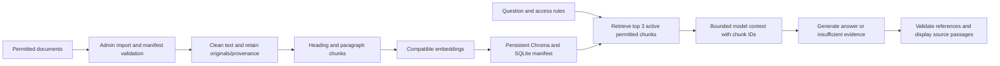

# IS373 Reviews 1–2 — evolving individual project record

Review 1 Plan due **November 17, 2026, 1:00 PM Eastern**. Review 2 Build deadline supplied by Canvas: **December 1, 2026, 1:00 PM Eastern**. Build audit/checks: November 23, 2026.
Owner: Kushal Patel. This is the single individual record; extend its two sections through Build, Checked Release and Improve. Research and implementation are AI-assisted. The portfolio and RAG pipeline are now implemented and checked locally as detailed below. The approved Docker/Traefik HTTPS deployment and complete real import → semantic retrieval → Gemini answer → opened citation journey are verified. The owner confirmed the Free tier with no linked billing account and configured a replacement key privately. No paid service was enabled. Personal understanding and peer feedback are not inferred. Earlier Plan prose is retained as historical evidence, not current implementation status.

[Repository](https://github.com/kushalpatel71/my-app-studio) · [Plan branch](https://github.com/kushalpatel71/my-app-studio/tree/feature/review1-plan) · [Issue #7](https://github.com/kushalpatel71/my-app-studio/issues/7) · [PR #8](https://github.com/kushalpatel71/my-app-studio/pull/8) (merged November 23, 2026 at `1efd73e`)

## Instructor requirements and repository audit

**Review 2 access note (November 23):** the supplied current portfolio, individual and milestones pages returned a 114-byte client redirect stub to `/lander`; the GitHub source fallbacks returned 404. The correct official Markdown fallbacks were subsequently found and read: [portfolio brief](https://github.com/kaw393939/is373-studio/blob/main/docs/projects/portfolio.md), [individual RAG brief](https://github.com/kaw393939/is373-studio/blob/main/docs/projects/individual.md), [milestones](https://github.com/kaw393939/is373-studio/blob/main/docs/course/milestones.md). Their earlier November 24 date is superseded by the supplied authoritative Canvas **December 1, 1 PM Eastern** deadline. Prior November 9 source-reading notes below remain historical.

All five required pages were read on November 9 using direct HTTPS retrieval after browser-tool errors:
[milestones/rubric](https://kaw393939.github.io/is373-studio/course/milestones.html), [career handout](https://kaw393939.github.io/is373-studio/handouts/career-research.html), [database/RAG handout](https://kaw393939.github.io/is373-studio/handouts/database-rag-research.html), [record template](https://kaw393939.github.io/is373-studio/templates/project-record.html), [Plan example](https://kaw393939.github.io/is373-studio/examples/plan.html).
The Plan requires research, alternatives, a justified design and expected checks. A hosted link is optional at Plan. Canvas remains authoritative for the assignment box and deadline.

Audited latest remote `main`: [`15eaa35f87ed405d9dba3716a290f180d9fa4984`](https://github.com/kushalpatel71/my-app-studio/commit/15eaa35f87ed405d9dba3716a290f180d9fa4984). Fresh clone had a clean tree; `feature/review1-plan` was created from that revision. Read [README](../../README.md), [AGENTS](../../AGENTS.md), [SPEC](../../SPEC.md), [LEARNING](../../LEARNING.md), all three [lessons](../lessons/), source, security/database helpers, request/browser tests, contracts and CI. Origin is now `git@github.com:kushalpatel71/my-app-studio.git`; this is the student's public repository, not the instructor template.

| Stage | Real implementation and acceptance evidence | GitHub state verified through connector |
|---|---|---|
| APP-001 | [Showcase router](../../app/showcase.py), [brand/sample data](../../app/brand.json), templates/CSS, [route tests](../../tests/test_showcase.py), [homepage contracts](../../contracts/test_homepage.py), [browser journeys](../../tests/browser/test_browser.py). Home, build index, three detail pages, About; unknown slug 404; Next Step retained. | [Issue #1](https://github.com/kushalpatel71/my-app-studio/issues/1), [PR #2](https://github.com/kushalpatel71/my-app-studio/pull/2) merged at `fedd07c`. |
| APP-002 | [Accounts](../../app/features/accounts.py), [security](../../app/security.py), [SQLite database](../../app/database.py), [account contracts](../../contracts/test_accounts.py), [route tests](../../tests/test_account_routes.py). Signup member-only, hashing, HttpOnly JWT session, CSRF, private dashboard, server revocation at logout. | [Issue #3](https://github.com/kushalpatel71/my-app-studio/issues/3), [PR #4](https://github.com/kushalpatel71/my-app-studio/pull/4) merged at `e4f0753`. |
| APP-003 | [Roles](../../app/features/roles.py), [role contracts](../../contracts/test_roles.py), [admin tests](../../tests/test_admin_routes.py). Anonymous API 401, member 403, admin allowed; current database role overrides stale JWT role; trusted CLI changes affect existing sessions. | [Issue #5](https://github.com/kushalpatel71/my-app-studio/issues/5), [PR #6](https://github.com/kushalpatel71/my-app-studio/pull/6) merged at `15eaa35`. |

All three implementations are present on main; [studio.json](../../studio.json) declares `implemented_through: 3`. Historical SPEC/LEARNING contain stale pending/open language, including contradictory merge notes. Actual merged PR metadata and Git history establish integration; old prose is not treated as current status. Prior learner observations/AI help are attributed only to those existing records; this audit does not independently prove understanding or authorship. Current check receipt is recorded below. No existing application, test, contract, marker, workflow, SPEC or LEARNING content is changed by this Plan.

### 1. Individual portfolio + career research

#### Review 2 Build — current implementation, November 23, 2026

**Status:** responsive public portfolio implemented and hosted. [Portfolio](https://carbuilders.192.81.212.73.sslip.io/portfolio) · [Car Builders Place](https://carbuilders.192.81.212.73.sslip.io/) · [RAG case study](https://carbuilders.192.81.212.73.sslip.io/portfolio/projects/rag) · [working assistant](https://carbuilders.192.81.212.73.sslip.io/rag). [Issue #9](https://github.com/kushalpatel71/my-app-studio/issues/9) · [PR #10](https://github.com/kushalpatel71/my-app-studio/pull/10), merged into main. The branch started from merged Review 1 main `1efd73e16552abf3336e0dd897c903300225db82`.

[Portfolio template](../../app/templates/portfolio.html), [RAG case study](../../app/templates/rag_case.html), [additive routes](../../app/features/review2.py) and scoped CSS implement the evidence-first layout. NJIT student/developer identity and provisional **AI Application / Product Engineering**, with FDE as a comparison, come from the owner’s task. No employment history, credentials or independent AI expertise is invented. About, Skills, Projects, Research and Contact anchors work by keyboard. Project links open the original car site, actual RAG case study/app, public code, account/role PRs and the single project record.

**Research finding → design:** Review 1’s GovWell research emphasized grounded AI/evaluation, motivating visible retrieved IDs, sources and actual query outcomes. The Palantir comparison motivated inspectable delivery decisions. Evidence-first usefulness to recruiters remains a design hypothesis until a real reader tests it. Earlier three-posting evidence, role comparison, responsibility map and alternate layout remain below as historical research.

Car Builders Place’s case study links actual FastAPI/Jinja, SQLite accounts, signed/revocable sessions, CSRF, current-role authorization and testing. Its homepage remains `/`; car index/details, About, signup/login/dashboard/logout, account database behavior and administrator checks are preserved. The RAG case study now records a real hosted journey rather than a planned chatbot. Skills are linked to implementation evidence and AI assistance is disclosed.

**Contact:** the supplied GitHub profile and the existing public application repository provide a working project-contact route via GitHub issues. No inferred email from infrastructure is published. Optional LinkedIn/résumé links are omitted because none was supplied. No message is sent by adding this link.

##### Verified group planning contribution

Authenticated read-only GitHub inspection found the private group project and the owner’s actual November 12 Plan review. It confirms responsibility for the reader interface, editorial approval workflow, shared documentation and integration, plus support for comparing keyword-only retrieval before assuming a graph is worthwhile. The review event was **COMMENTED**, not an approval or implementation result. The team record discloses AI assistance in research/documentation.

The public case study publishes only this high-level own-contribution summary: **verified Plan review and coordination; no implemented group feature or hosted group demo claimed**. The private repository URL, teammate details and private source text are not reproduced publicly. No group repository file, issue, PR or deployment was changed by this Build. Later group implementation claims require their own verified contribution evidence.

**Actual checks:** `python3 studio.py check` passed Black/Pylint, **120 application/request/tooling tests, 18 unchanged APP-001–003 instructor contracts and 15 real Chromium cases**. The base Python 3.14 environment explicitly skips optional real-Chroma and local-provider-simulation cases; they ran separately under Python 3.12. Hosted Chromium verified anonymous access, project/anchor keyboard navigation and no horizontal overflow at 1440/390/320px. The actual hosted journey reached Portfolio → RAG project → question → real vector trace → **real Gemini answer** → opened supporting passage. Hosted browser login/dashboard/logout and car images also passed. [Real browser receipt](../rag/hosted-browser-evidence.json) · [API/retrieval receipt](../rag/hosted-api-evidence.json) · [generated-answer receipt](../rag/hosted-generation-evidence.json).

**Changed:** added public portfolio/case study, accurate project/contribution labels and GitHub contact/navigation without replacing the car website. **Checked:** actual local/CI/browser/hosted access, layout, authentication and full cited-answer journey. **Next for December 3:** maintain current case-study/version links, add supplied optional professional material, and obtain the owner’s own interpretation/reader observation. **Contribution / AI assistance:** owner supplied direction/scope, approved Docker reuse, configured/rotated the key and confirmed the Free tier. AI authored implementation, original guides, tests and this factual record; AI browser observations are separate from human feedback. No personal reflection or understanding is fabricated.

#### Historical Review 1 portfolio research and plan

**Historical Plan status (November 9):** Research and Plan drafted; student reflection/selection review pending. The earlier November 24 Build date is superseded by the supplied Canvas December 1 deadline.

#### Research: three original employer records

These saved evidence notes summarize original employer-hosted postings checked **2026-11-09**. Direct HTTPS retrieval succeeded for all three. Palantir and GovWell include public JobPosting JSON-LD; Datadog includes readable posting/application text. The browser index also supplied matching descriptions, but direct original content was checked to avoid relying only on search snippets. No screenshots or applications were created. Public research summaries are suitable for this record; personal eligibility judgments and full career reflection stay private. These three examples do not establish market trends.

**J1 — Palantir Technologies, “Forward Deployed Software Engineer, New Grad - Commercial.”** Enterprise software; FDE family. [Original posting](https://jobs.lever.co/palantir/2e6b0ac8-83e9-4be5-a3aa-cf319f751728).

- Status: page/application available on check date; future vacancy unconfirmed. JSON-LD posted June 13, 2025; deadline not stated.
- New York, NY; full-time, hybrid; new graduate. Travel expectation 25–50% depending on team/location. Requires December 2026 or Spring 2027 graduation; student's graduation/work authorization and sponsorship eligibility unverified.
- Responsibilities: collaborate on architecture; build customer-specific applications/LLM workflows; manage stakeholder relationships through delivery.
- Required: engineering degree, programming proficiency, specified graduation window. Preferred degree fields include computing, engineering, mathematics and related sciences. “What We Value” emphasizes autonomy, ambiguity and customer outcomes; it is not a separate mandatory credential list.
- Supporting excerpt, “What We Require”: “Must be graduating in December 2026 or Spring 2027.”
- Existing evidence: Python/FastAPI application and server permission boundaries in APP-002/003 above; no enterprise customer delivery claimed.
- Gap: customer discovery/delivery experience. Proposed action by **November 12**: write three discovery questions for an actual portfolio reviewer and confirm graduation/travel eligibility privately.

**J2 — GovWell, “AI Product Engineer.”** Government software; AI product/application family. [Original posting](https://jobs.ashbyhq.com/GovWell/7c4cff34-bd8d-41d7-a54b-8f9ee0d96ac3/).

- Status: active posting metadata with direct application on check date; future vacancy unconfirmed. JSON-LD posted February 24, 2026; deadline not stated.
- New York, NY; full-time, hybrid, 3+ office days/week. Numeric seniority/years not stated; production experience makes this a longer-term reference, not verified entry-level eligibility. US location metadata; sponsorship/work authorization not established. Metadata says TELECOMMUTE but prose requires hybrid attendance; follow the more specific prose.
- Responsibilities: improve assistant retrieval/evaluation; prioritize fixes using production usage; ship and iterate AI features.
- Expected qualifications (“Who you are”): production LLM/RAG or evaluation experience, full-stack ability, product judgment and autonomy. No separately labeled preferred list; listed stack is context, not proof every technology is required.
- Supporting excerpt, “Who you are”: “Strong full-stack ability”.
- Existing evidence: FastAPI UI/API, automated account/role tests and iterative showcase delivery. This supports foundations, not existing AI expertise.
- Gap: evaluated retrieval/generation. Proposed action by **November 16**: finalize five expected-source questions and a citation-failure check for the RAG Build.

**J3 — Datadog, “Software Engineering Intern.”** Observability/security software; general software/platform family. [Original posting](https://careers.datadoghq.com/detail/8114186/?gh_jid=8114186&source=relomote.com), requisition 1065.

- Status: original description and application section available on check date; future availability unconfirmed. Posting date/deadline not visible.
- Paris, France; internship, hybrid. Pursuing CS/software engineering/related degree or equivalent practical experience; targeting 2027 full-time start; available six months starting February–June 2027. Student availability, relocation, French work authorization and sponsorship remain unverified; this is a verified internship posting, not a confirmed suitable application.
- Responsibilities: contribute to live observability data systems; improve distributed/cloud services; address performance/reliability/scaling problems.
- Qualifications under “Who You Are”: CS fundamentals, programming, AI-tool experience or interest, degree/equivalent and timing above. No separate preferred-qualification list. Kubernetes is a learning area, not an explicit prerequisite.
- Supporting excerpt, “Who You Are”: “Targeting a 2027 full-time start date”.
- Existing evidence: Python service, automated tests and GitHub PR delivery; no distributed-system scale claimed.
- Gap: distributed-systems observability. Proposed action by **November 13**: sketch request/error/latency measurements for the RAG service and privately verify internship timing/location eligibility.

#### Compare directions and choose the reader

| Direction | Regular work in this sample | Existing evidence | Missing evidence / course experiment |
|---|---|---|---|
| AI application/product engineering | GovWell: user-facing AI features, grounded answers, evaluation and iteration | FastAPI UI/API; security/access checks; documented showcase revision | RAG import/query trace and citations with expected-versus-observed evaluation; no production LLM work yet |
| Forward deployed engineering | Palantir: customer-specific integration, architecture and stakeholder delivery | Bounded application decisions and working account/role implementation | Real discovery, enterprise integration, stakeholder adoption and travel fit; course reviewer task can begin discovery but cannot establish professional FDE experience |

Platform engineering (Datadog) is a third family investigated: useful for reliability learning, with distributed-system depth still missing. **Recommendation:** provisionally target entry-level **AI Application / Product Engineering**, keeping FDE as a comparison. The current artifact evidence is closest to building and checking application behavior; a small RAG evaluation directly addresses the AI gap. This is an AI-assisted fit inference, not a claim that Kushal meets GovWell's experience bar or has confirmed personal travel preferences. The user supplied the provisional interest; personal reasons remain for the private reflection.

**Target reader:** a recruiter or internship reviewer hiring for entry-level AI application development. After viewing the portfolio, the reader should identify the intended direction, inspect one implemented capability, and distinguish completed work from planned AI work and the student's own contribution from AI/team help.

| Employer responsibility | Portfolio evidence today | Clearly labeled future evidence |
|---|---|---|
| GovWell: improve retrieval grounding/evaluation | Existing [test structure](../../tests/) demonstrates application checking only | RAG case study: versioned manifest, retrieved chunk IDs, five actual query results, claim/citation review and one improvement/retest |
| Palantir: build custom applications and make architecture decisions | [Showcase routes](../../app/showcase.py), [SPEC](../../SPEC.md), [PR #2](https://github.com/kushalpatel71/my-app-studio/pull/2) show a bounded enthusiast task and multi-page revision | Real reader discovery note; never label class/AI feedback as enterprise customer work |
| Datadog: own technical delivery with other engineers | [Check workflow](../../.github/workflows/check.yml), merged PRs above and actual checks below | Group case study with named issue/PR, personal diff, reviewer and integrated result; group repository and contribution not yet provided |

#### Plan: same content, two lightweight layouts

Shared content inventory for both options: introduction/direction, evidence-supported skills, individual RAG case study, group contribution case study, repositories/demos/checks, optional resume/LinkedIn, contact.

```text
Option A — Evidence-first (recommended)
Header: Kushal Patel | Projects | About | Contact
Short intro + provisional AI application direction
Featured work: Car Builders Place [implemented] | RAG [planned]
Case studies: task → my contribution/help → decision → evidence → limits
Skills with source links → Group work [pending evidence]
About → GitHub / demo links → optional resume/LinkedIn → contact

Option B — About-me-first
Header: Kushal Patel | About | Projects | Contact
Introduction + interests/direction
About and evidence-supported skills
Same project cards and case studies → same group-work placeholder
Same GitHub / demo links → optional resume/LinkedIn → contact
```

Choose **A** provisionally: it exposes inspectable work early for the target reader. The expected benefit is faster evidence discovery; this is a design hypothesis, not a peer-tested result. B may support a stronger personal narrative, but no employment history or credentials were supplied to populate that narrative. Use readable typography, restrained charcoal/lime accents related to the existing project, clear headings/focus, high contrast and responsive stacking. A practical “builder” voice is proposed; expertise should be demonstrated through links, never invented endorsements.

**Planned implementation/page outline:** reuse FastAPI/Jinja/shared styles on additive `/portfolio` and project-detail routes; leave existing Home/build/account/admin URLs and Next Step intact. Intro identifies the provisional direction without calling planned RAG work a mastered skill. Skills link Python/FastAPI, HTML/CSS, SQLite sessions, authorization and testing to the audited artifacts. Individual case study will show corpus permission, architecture, actual trace, setup and limits once built. Group case study requires a real group repository, task, personal contribution and review evidence; currently placeholder only. GitHub points to this repository. Demo URLs remain “not yet hosted”; no invented domain. Resume and LinkedIn are omitted until supplied. Professional contact is pending a student-approved email or contact URL; do not expose an inferred address.

**Planned observable portfolio checks (not executed):**

1. A reader can find the intended role and one linked implemented artifact from `/portfolio`; headings and links work by keyboard at desktop and 390px.
2. Each skill/case-study claim has a working evidence link and an accurate implemented/planned label; group contribution never implies sole authorship.
3. RAG project link opens a clearly labeled case study and, after Build, its actual chat; placeholder never resembles a working result.
4. Contact/resume/LinkedIn show only supplied, reviewed details; missing optional links are omitted and the chosen contact route is checked before publication.

**Changed:** added three sourced employer notes, comparison, target reader, mapping, two layouts and implementation outline. **Checked:** original postings and repository evidence read; no portfolio usability test or human review performed. **Next:** student confirms direction/layout and privately checks eligibility by November 12; confirm contact and group contribution links by November 16. **My contribution / AI assistance:** user supplied project/repository, constraints and provisional interest; AI researched, audited and drafted recommendations. Student's personal rationale, reflection and understanding have not been supplied and are not fabricated.

**Build / Checked Release / Improve:** pending. Future dates are November 24, December 3 and December 10 respectively; later add actual hosted revision, link/access checks and real peer observation → meaningful fix → retest here.

### 2. Individual RAG app + technical research

#### Review 2 Build — current implementation, November 23, 2026

**Status:** genuine hosted RAG demonstrated. [Assistant](https://carbuilders.192.81.212.73.sslip.io/rag) · [case study](https://carbuilders.192.81.212.73.sslip.io/portfolio/projects/rag) · [actual five-question generation evidence](../rag/hosted-generation-evidence.json) · [real browser journey](../rag/hosted-browser-evidence.json). This is real Gemini generation, not the isolated test simulation.

**Architecture and compatibility.** Retain FastAPI/Jinja and existing security/account services. Verified CPU runtime: Python 3.12, Chroma **1.5.9**, ONNX Runtime **1.23.2**, tokenizers **0.23.3**, NumPy **2.5.5**, Hugging Face Hub **0.36.0**, and existing `httpx==0.28.1`. MiniLM produces actual **384-dimensional embeddings**. The original Python 3.14 environment had no matching ONNX Runtime wheel, and unpinned Sentence Transformers/Chroma resolution failed. Chroma’s CPU ONNX export of Sentence Transformers `all-MiniLM-L6-v2` avoids the heavier PyTorch runtime; intra/inter-op threads are explicitly one. The pinned downloader verifies model archive SHA-256 `913d7300ceae3b2dbc2c50d1de4baacab4be7b9380491c27fab7418616a16ec3`.

Use cosine vectors for the semantic experiment and SQLite FTS5 over the same active passages as the simpler keyword baseline. No graph database/hybrid fusion was added: five short guides and the measured set do not demonstrate a need. Both approaches ranked the expected source first for all four supported questions. This is **not evidence that vector search outperforms keyword search**; the authored paraphrase guide includes matching vocabulary. The historical graph/vector/entity/relationship research remains below.

**Real provider and cost.** The actual model is `gemini-3.5-flash-lite`, with text/structured-output support verified through current [official model documentation](https://ai.google.dev/gemini-api/docs/models/gemini-3.5-flash-lite) and a model-metadata HTTP 200. The owner confirmed the project displays **Free tier, with no billing account linked**, and privately configured a replacement API key. This is owner-confirmed project status, not an automated Cloud Billing audit. No paid project, billing account, credits or usage upgrade was enabled. Model pricing checked November 23 lists free input/output on the Free tier; paid reference rates are $0.30 input / $2.50 output per million tokens. Free-tier provider data terms are disclosed in the UI. Only public project passages/questions go to Gemini; no account data or secret enters context.

**Observed provider fix:** the original `temperature=0` RAG request hit the real 20-second timeout; a bounded 45-second diagnostic also timed out. Minimal default-setting inference returned HTTP 200 in 0.75 seconds. Changing **only** the RAG sampling override to the model default produced a real cited answer in **0.87 seconds**. The app now follows Google’s [recommended default sampling](https://ai.google.dev/gemini-api/docs/troubleshooting#check-api); the 20-second timeout was retained. No citation assertion was weakened to obtain this result. An initial response during reload was a gateway 404 while Docker health was starting; initial health polling is now every two seconds during a ten-second start period, without changing existing proxy configuration.

**Source/import manifest.** [Manifest](../rag/corpus/manifest.json): five original AI-authored project guides requested by the owner for public/provider-context use. Attribution is not presented as independent student authorship. No employer text, photos/manuals, private account records or personal reflection is indexed.

| Source | Actual file / origin | Version / permission | Chunks |
|---|---|---|---:|
| CBP-S01 · Site navigation | [navigation.md](../rag/corpus/navigation.md), checked against showcase routes | v1 / original project text; public/provider context | 3 |
| CBP-S02 · Understanding sample builds | [sample-builds.md](../rag/corpus/sample-builds.md), checked against brand data | v1 / same permission | 3 |
| CBP-S03 · Modification categories | [categories.md](../rag/corpus/categories.md), original bounded glossary | v1 / same permission | 4 |
| CBP-S04 · Accounts and access | [access.md](../rag/corpus/access.md), checked against account/role routes | v1 / same permission | 4 |
| CBP-S05 · Assistant scope/provenance | [assistant-scope.md](../rag/corpus/assistant-scope.md), original policy guide | v1 / same permission | 4 |

Actual persistent generation: **`c8f0e4d840fdef5f40a4f4ec`, 5 documents / 18 chunks**. [Importer/storage](../../app/rag_store.py) validates the whole allowlist before activation: ordinary UTF-8 Markdown inside the fixed corpus root, ≤5 documents/20 KB each, unique IDs, version/title/origin/author/permission, no symlink/traversal/HTML. It normalizes line endings/whitespace and chunks heading/paragraph text at a real **≤200-word-piece** cap. IDs include source/version/hash/ordinal. SQLite retains exact text/provenance/raw SHA; Chroma persists vectors in a staged snapshot. One SQLite transaction activates the complete generation after staging succeeds. Unchanged import is idempotent; changed bytes/provenance require a version bump. Current vector/keyword retrieval excludes retired/removed sources, while historical citations remain addressable. Exact retained passages/hashes locate evidence; original character offsets and retention cleanup remain future work.

**Actual representation / trace.** For “Where does View Details take me?”, the selected passages were:

| Rank | Chunk | Cosine |
|---|---|---:|
| 1 | `CBP-S01-v1-40f3df8f794e-2` | 0.42770 |
| 2 | `CBP-S02-v1-d8b616f8c5ce-2` | 0.31188 |
| 3 | `CBP-S01-v1-40f3df8f794e-3` | 0.31140 |

The first chunk is a retained `Site navigation` paragraph explaining that View Details opens an individual sample detail page, giving the Skyline/Miata/BMW paths and the Car Builds → View Details workflow. [Open the actual versioned passage](https://carbuilders.192.81.212.73.sslip.io/rag/sources/CBP-S01-v1-40f3df8f794e-2). The real generated answer was **“View Details opens an individual sample build detail page.”**, citing that exact chunk. AI compared the generated claim with the opened passage; no student interpretation is inferred.

**Executed five-question evaluation.** [Full actual answers, traces, opened passages, latency and retained failure](../rag/hosted-generation-evidence.json); [keyword/vector receipt](../rag/retrieval-evidence.json).

| Type / question | Expected source | Actual real Gemini result | Actual citation / observation |
|---|---|---|---|
| Exact: Where does View Details take me? | CBP-S01 | Individual sample build detail page | `CBP-S01-v1-40f3df8f794e-2`; source opened 200; 3.763 s |
| Paraphrase: Where can I look at the upgrades on one example car? | CBP-S01 | Open Car Builds, then View Details | Same navigation chunk; opened 200; 1.103 s on successful retry |
| Relationship: Which role may access the administration page? | CBP-S04 | Only the administrator role | `CBP-S04-v1-a9408862c957-3`; opened 200; 0.984 s |
| Glossary: What does the suspension category describe in this assistant? | CBP-S03 | Sample ride-height and handling concept | `CBP-S03-v1-b9ba1459dd37-2`; opened 200; 1.162 s |
| Unanswerable: What measured horsepower gain will this build give my car? | No numeric claim; CBP-S05 scope | Insufficient evidence in the approved corpus | `insufficient=true`, no citations/number; real generation executed; 0.781 s |

Final question types passed **5/5**. One earlier paraphrase attempt returned safe HTTP 503 from the provider/validation boundary and displayed no answer; it is retained in `observed_failures`, not erased or counted as a pass. Its exact upstream/validation cause was not captured, so none is invented. The retry returned a valid supported answer. This tiny set and these latency samples do not establish broad accuracy, first-attempt reliability or production load capacity.

**Security and failure behavior.** [HTTP contract](../rag/API.md), [routes](../../app/features/review2.py), [Gemini boundary](../../app/rag_generation.py). Public questions need no signup. Import requires the **current** administrator role and existing synchronizer CSRF; the fixed directory cannot be chosen by the caller, and even a streamed/chunked nonempty request body is rejected. 8192-byte body cap, 1000-character question cap, five questions/minute per socket peer, 100 attempted generations/UTC day and one active generation bound use. Behind Traefik the peer limit is conservatively shared across visitors. Top-three passages scoring ≥0.30 become context; no relevant context skips generation. Returned citation IDs must be retrieved IDs; unknown/inline-invalid IDs invalidate the answer. Text is escaped/assigned with `textContent`; model HTML is never executed. Valid IDs alone do not prove every claim; human support review remains necessary. Missing keys, unapproved project, timeouts and provider/validation failures show honest errors and available traces. No question text is stored by the app, and Chroma has no public listener.

**Executed checks / expected → actual:**

| Check | Actual result |
|---|---|
| Complete `python3 studio.py check` | Black/Pylint; 120 application/tooling/request tests, 18 unchanged instructor contracts, 15 Chromium cases passed |
| Real Chroma/CPU lifecycle suite | 8 passed: 384 dimensions; import 5/18; reimport unchanged; expected retrieval; required version bump; v2/removed sources excluded from current hits; old citations retained; invalid import leaves active state; new-process persistence |
| Public/access/input/citation suite | 10 passed; anonymous import 401, member 403, admin without CSRF 403, admin+CSRF reaches importer, arbitrary body/path 400 including streamed body, same-session demotion 403 |
| Local actual-HTTP Postman simulation | 5 passed: modeled success/abstention, HTTP failure, delayed response, invalid citations, real embedding → simulated provider → actual source; **not** real-generation evidence |
| Full combined Python 3.12 non-browser environment | **151 passed**, including all original regression/contracts, real vectors and local HTTP simulation; 15 browser cases deselected and run separately |
| Production-image server regression | Initially 9 failed / 87 passed; corrected dependency selection then **96 passed** using the exact same assertions |
| Hosted API and browser | Public pages/cars/forms 200, unknown car 404, private redirect, actual signup/login/dashboard/logout, secure cookie flags, direct role/CSRF checks, current-role changes, revoked/invalid token 401; real five-question/citation evaluation and complete browser journey passed |

**Dependency issue found and fixed.** Chroma’s transitive Hugging Face Hub 2.4.0 pulled `httpx2`; Starlette selected that client, whose cookie replacement behavior caused existing altered-JWT tests to retain/send the original valid cookie. No auth implementation or failing assertion was changed. Pinning compatible Hub 0.36.0 preserves the original `httpx==0.28.1` semantics; Hub is not used by this direct ONNX downloader. The unchanged security suite plus vectors passed 59 cases; all 117 installed packages passed compatibility checks. RAG CI now runs the whole non-browser regression/contracts, catching this combination rather than only testing the new feature.

**Approved Docker hosting and preservation.** [Dockerfile](../../deploy/Dockerfile), [Compose](../../deploy/compose.yml), [private-env example](../../deploy/app.env.example), [build/restart/backup/rollback runbook](../../deploy/README.md). Read-only preflight verified the existing `is373-server`, 1 CPU, 1967 MiB RAM/~1421 MiB available, 44 GiB initial free disk, Docker 29.1.3, calculator/Traefik/practical-prod/practical-qa and `hosting-web`. The owner approved one new app/volume/hostname. The app uses one worker, non-root `10001:10001`, read-only root, dropped capabilities, 768 MiB/.75 CPU cap, no published host port, and persistent `cbp-review2_app-data:/data` for auth, vectors, metadata, counters and model cache. Secrets remain in the owner-only server env file, not the image/repository. Current disk sampling still showed 40 GiB free. Observed model-loaded memory samples were within the 768 MiB limit; these are not peak-load guarantees.

Public HTTPS and the real browser verified the new origin. Traefik’s existing Docker labels/default `websecure` resolver issued a trusted Let’s Encrypt certificate (matching hostname, expiry February 21, 2027); no proxy config edit/restart was needed. All four original containers retained IDs/images/start times/restart counts/ports/networks and existing static/dynamic proxy hashes. [Calculator](https://calc.192.81.212.73.sslip.io/health), [original production](https://192.81.212.73.sslip.io/) and [original QA](https://qa.192.81.212.73.sslip.io/) returned trusted HTTPS 200; production/QA response bytes matched preflight. No original container or volume was deleted. Only the new app was reloaded for its release/secret configuration. Startup/model-download logs showed no critical error.

**Persistence / backup / release evidence.** New-app restart retained 5/18, the same semantic source and the disposable account. A consistent volume backup was created with only this app stopped, copied off-host into ignored owner-only runtime storage and checksum-verified. Offline restore into a **separate local volume** recovered 5/18, the same semantic result and account-table presence; no live volume was restored. A separate offline restored-account check passed login/dashboard/logout with a disposable signing key; the original server signing key was not copied. A final app-only restart preserved an existing authenticated session, current-role denial and real cited Gemini generation; logout token replay returned 401. [Restart and recovery receipt](../rag/hosted-persistence-evidence.json). Production rollback has not been executed. Raw backup/baseline/credentials are not in GitHub.

Final browser, restart and real-generation checks used [deployed release 517b03c](https://github.com/kushalpatel71/my-app-studio/commit/517b03c947c4fb0e14947fbda98fab11b850a267). The first five-question evaluation used [provider fix 7aeaef6](https://github.com/kushalpatel71/my-app-studio/commit/7aeaef6a48e13c1315af71208595a06403596279). Earlier [implementation 3387adc](https://github.com/kushalpatel71/my-app-studio/commit/3387adc7ded7ab6164d8af92b54b6cf6c40d269f) and [dependency correction 827829f](https://github.com/kushalpatel71/my-app-studio/commit/827829f9444dd35ea8390c787fd506b6883709e5) preserve the progression. [Issue #9](https://github.com/kushalpatel71/my-app-studio/issues/9) · [PR #10](https://github.com/kushalpatel71/my-app-studio/pull/10) · [latest PR checks](https://github.com/kushalpatel71/my-app-studio/pull/10/checks). The owner approved merging; PR #10 merged into main as `04db6b614e706f5577ff72e4699ed9ef5510383e`.

[Deployed-release CI 45252943773](https://github.com/kushalpatel71/my-app-studio/actions/runs/45252943773) passed all three jobs: Linux (120 + 18 contracts + 15 Chromium), Windows (118 + 18 + 15; two existing POSIX-only cases skipped), and expanded RAG (146 passed, five optional local-simulation cases skipped, 15 browser cases deselected, Docker build/startup passed). The final published revision’s required jobs are checked through the PR checks link. Local simulation and live Gemini evidence are separate.

**Repeatable checks:** ordinary `python3 studio.py check`; Python 3.12 optional runtime via `requirements-rag.txt`; `python -m pytest -q tests -m "not e2e" contracts`; `python scripts/evaluate_rag.py --index PRIVATE_INDEX_PATH`. `--generate` explicitly requests actual approved generation. For local provider simulation use `postman simulation run postman/simulations/review2-provider.sim.yaml --port 4511 --no-history` and `RAG_SIMULATION_URL=http://127.0.0.1:4511/gemini/v1beta/models/ python -m pytest -q tests/test_rag_provider_http.py`. No real credential is used in mocks/CI.

**Changed:** implemented actual import, neural embeddings, persistent vector/keyword retrieval, real Gemini generation, verified source UI, guarded administration, tests and existing-server Docker hosting. **Checked:** actual local/CI/container/hosted/browser outcomes above, with failures and simulation distinguished. **Next for December 3:** broaden independent query/load checks, improve structured-output observability/reliability, source offsets/retention and trusted-proxy per-client limiting based on measured needs; rehearse production rollback when separately approved and obtain the owner’s own interpretation/reader review. **Contribution / AI assistance:** owner selected scope/direction, approved deployment, configured/rotated the private key and confirmed Free-tier status. AI researched, authored code/corpus/tests, diagnosed dependency/sampling issues and executed the reported checks. No peer feedback, personal reflection or independent understanding is fabricated.

#### Historical Review 1 technical research and plan

**Historical Plan status (November 9):** proposed Car Builds Knowledge Assistant; research/design only at that time. The current Build status above supersedes these earlier planned-implementation statements.

**Reader/task:** a Car Builders Place visitor asks how to navigate the sample builds and how to interpret illustrative modification information. Answer only from approximately five short owner-authored help documents. Exclude repair instructions, safety advice, measured performance, fitment claims and personal/account data. A small informational assistant provides a bounded portfolio case study.

#### Technical research and primary sources

Access date for the sources below: **2026-11-09**. These are research references, not permission to import their text into the corpus.

| Concept / source and relevant section | Explanation and design implication |
|---|---|
| [Lewis et al., RAG paper](https://arxiv.org/abs/2005.11401), abstract | RAG combines retrieval from external indexed evidence with generation. Our planned inference workflow retrieves passages before asking a model to answer; this is not a claim to reproduce the paper's training or results. |
| [Chroma adding data](https://docs.trychroma.com/docs/collections/add-data), Adding Data; [Chroma repository](https://github.com/chroma-core/chroma), Python client examples | A vector database stores embeddings and metadata with identifiable records for similarity retrieval. Chroma's unique IDs/document metadata support provenance. Local persistence/version compatibility must be verified in Build. |
| [MiniLM model card](https://huggingface.co/sentence-transformers/all-MiniLM-L6-v2), Intended uses / Usage | Embeddings map text into numeric representations for semantic comparison; they do not verify facts. This model outputs 384 dimensions and truncates beyond 256 word pieces by default. Record model revision/tokenizer and avoid silent truncation. |
| [Neo4j graph concepts](https://neo4j.com/docs/getting-started/appendix/graphdb-concepts/), nodes/relationships/properties | A graph represents entities (build, modification category, document) and typed relationships. Provenance must support every edge; extracted or inferred links can be wrong. |
| [SQLite FTS5](https://www.sqlite.org/fts5.html), Overview / query syntax / BM25 | Keyword search matches indexed terms and can rank passages; SQL filters explicit fields. This is a small reproducible baseline for source IDs and exact terms. |
| [Sentence Transformers models](https://www.sbert.net/docs/sentence_transformer/pretrained_models.html), Loading Models | Query and document encodings must use compatible configuration. Pin the actual model revision and package versions during implementation. |
| [Gemini 3.5 Flash-Lite](https://ai.google.dev/gemini-api/docs/models/gemini-3.5-flash-lite), model code/capabilities; [pricing](https://ai.google.dev/gemini-api/docs/pricing) | Proposed hosted generation model `gemini-3.5-flash-lite`; text output and structured output are documented. Availability to this account, actual cost and SDK compatibility remain untested. Vendor pricing is variable: check the current tier before enabling calls. |

Source provenance records who authored a document, its version/origin, permission and exact passage location. Import converts approved input into retained originals and cleaned text. Chunking splits that text into evidence units while keeping source mappings. Retrieval chooses relevant permitted units, model context packages those units with IDs, generation drafts an answer, and citations let readers inspect support. Citation validity requires both a real source location and support for the associated claim; a valid-looking ID alone is insufficient.

#### Compare bounded approaches and decide

| Approach | Representation / useful task | Cost and limit for this corpus |
|---|---|---|
| Keyword/SQL baseline | FTS5 passages plus structured source/version fields; exact “View Details” or source IDs | Few dependencies, deterministic inspection; paraphrases can miss wording |
| Vector | Chunk embeddings and cosine similarity; “where can I see the upgrades?” | May help paraphrases, requires model/index storage; nearest neighbor can still be irrelevant |
| Graph | Builds, categories, pages and typed edges; “which page describes this build?” | Explicit relationship traversal is inspectable; manual edge authoring/validation and another database are excessive for five short prose guides |
| Hybrid | Keyword + vector rank fusion with identical source filters, optionally graph traversal | Could retain exact terms and paraphrases; extra tuning and debugging need a measured benefit |

**Decision (proposed ADR R1): vector-first, retrieval-only baseline retained.** FastAPI/Jinja interface, Chroma local persistent store, `sentence-transformers/all-MiniLM-L6-v2` local embeddings, server-side Gemini `gemini-3.5-flash-lite` generation. Separate SQLite manifest/FTS5 database from the existing account database. Use one process/writer initially; no graph database or agent/tool execution. Passage-oriented questions fit vector retrieval; five documents do not justify graph operations. The choice tests a hypothesis about paraphrase retrieval, not a demonstrated improvement. Compare the same five queries using keyword and vector retrieval; add hybrid only if a specific observed miss warrants it.

**Simpler fallback:** SQLite FTS5 + the same generation API and source UI. If no API budget/access is available, provide an explicitly labeled search-only interface with quoted excerpts; it is not a completed RAG chat and does not satisfy the later real-generation Build requirement. Local embedding resource failure can trigger the FTS5 fallback without changing account/security behavior.

#### Proposed corpus and source manifest

All five entries below are **proposed, not authored/imported/permission-verified documents**. The intended author is Kushal Patel, with AI assistance disclosed if used. Their future owner approval must authorize storage, public demo excerpts and sending selected passages to the generation provider. Public repository availability does not alone authorize third-party reuse. No photos, employer text, copyrighted manuals, private reflections, student data, credentials or live account records enter the corpus.

| Stable ID | Proposed version/title and origin | Planned content and permission gate |
|---|---|---|
| CBP-S01 | v1 / Site navigation; planned `docs/rag/corpus/navigation.md` | Owner-authored description of Home, Builds, View Details and About, checked against [router](../../app/showcase.py). Pending author/license approval. |
| CBP-S02 | v1 / Understanding sample builds; planned `docs/rag/corpus/sample-builds.md` | Owner-authored explanation that samples are illustrative and not measured specifications, checked against [brand data](../../app/brand.json). Pending approval; no photo reproduction. |
| CBP-S03 | v1 / Modification categories; planned `docs/rag/corpus/categories.md` | New synthetic glossary of wheels, suspension, engine and performance labels; no vehicle fitment/repair advice. Pending author review/approval. |
| CBP-S04 | v1 / Accounts and access; planned `docs/rag/corpus/access.md` | Owner-authored public signup/login/dashboard/logout/member/admin explanation, checked against [accounts](../../app/features/accounts.py) and [roles](../../app/features/roles.py). Pending approval; exclude account details and promotion procedures. |
| CBP-S05 | v1 / Assistant scope and provenance; planned `docs/rag/corpus/assistant-scope.md` | New owner-approved assistant policy: interpret supplied sample content, expose sources, acknowledge absent measurements. Pending approval. |

Manifest fields to persist: `source_id`, title, author, version, original URI/path, origin type, license/permission evidence and approver/date, access scope, accessed/created date, raw SHA-256, cleaned SHA-256, active status, import outcome, chunking configuration, embedding ID/revision/dimensions and import time. Proposed paths become source URLs only after real files are created. Immutable source versions remain addressable for old citations; current retrieval excludes retired versions. Do not assign fabricated hashes or permission dates now.

#### Import and source-to-answer workflow



Graph alternative for comparison replaces chunks/embeddings with validated entities/relationships and bounded traversal returning supporting passages. It is not a second implemented pipeline.

1. Import allowlisted UTF-8 Markdown only, initially five files ≤20 KB each. Reject missing permission, invalid encoding, duplicate source IDs and out-of-root paths. No arbitrary URL fetching, uploads, PDFs or HTML in the initial scope.
2. Normalize line endings/whitespace; preserve headings, paragraph boundaries and original offsets. Do not remove qualifiers such as “illustrative.” Retain original and cleaned text with hashes.
3. Create deterministic versioned chunk IDs from source/version/section/ordinal and record exact text/span. Build a staging collection and activate a complete index version only after validation, avoiding partially updated results.
4. Repeat identical source/hash/config: report `unchanged` and keep counts/IDs. Changed source: create new version/chunks, retire old current entries atomically. Removed source: deactivate from retrieval, retain versioned source evidence under the retention rule. Re-embedding after model/chunker changes creates a new index version; never mix dimensions/models silently.
5. Question length ≤1,000 characters; retrieve top 3 chunks with active-version/public-scope filters. Apply the same filters before keyword and vector retrieval. Tune relevance/abstention on the small evaluation set, without claiming a universal similarity threshold.
6. Send only selected passages and their IDs, question and a fixed answer policy to the model. Source instructions are untrusted quoted data. Do not enable tools or let the model alter permissions. Require structured answer/claim-to-chunk references; no context means an insufficient-evidence response without an API call.
7. Reject nonexistent or unretrieved citation IDs; source links resolve through a server-controlled ID lookup to immutable passages. Review whether each factual claim is actually supported. Unknown/mismatched citations cause a safe error/abstention, not a fabricated source. Render escaped text and allowlisted links.

#### Representation sketches and chunking comparison

This is a **proposed synthetic sentence**, not imported repository content: “View Details opens an individual sample build page.”

```json
{
  "source_id": "CBP-S01",
  "version": "v1",
  "chunk_id": "CBP-S01:v1:navigation:001",
  "title": "Site navigation",
  "section": "Build details",
  "text": "View Details opens an individual sample build page.",
  "origin": "proposed docs/rag/corpus/navigation.md",
  "permission_status": "pending-owner-approval",
  "access_scope": "public-after-approval",
  "original_span": null,
  "content_sha256": null,
  "embedding_model": "sentence-transformers/all-MiniLM-L6-v2",
  "embedding_revision": null,
  "embedding_dimensions": 384,
  "embedding": null
}
```

Null values mean not computed, not verified. Numeric vectors must come from a real embedding run. Imports must reject this pending example until provenance/permission fields are complete.

**Graph sketch (comparison only):** `(Document {id:CBP-S01, version:v1}) -[DESCRIBES {support_chunk:CBP-S01:v1:navigation:001}]-> (Page {kind:BuildDetail})`; `(Link {label:View Details}) -[OPENS {support_chunk:...}]-> (Page {kind:BuildDetail})`. Validate each edge against approved text. A build/category `HAS_CATEGORY` edge would need its own explicit evidence; do not infer performance or part compatibility from category labels. Entity identity includes stable IDs; relationship properties retain source/version/span.

| Chunking method | Proposed parameters / trade-off | Worked boundary on a proposed fixture |
|---|---|---|
| Heading + paragraph (selected) | Keep heading with paragraph; cap at 200 word pieces measured with the pinned MiniLM tokenizer; split long paragraphs at sentences; no routine overlap | Keeps “Build details” with the full sentence. Retains semantic context; tiny sections may need title context. |
| Fixed characters | 40-character windows, 8-character overlap for the teaching sketch; later compare 600/100 as an experiment | On `Build details\nView Details opens an individual sample build page.`, first window ends `an indi`; next starts ` an individual...`. Repeats text and can sever the useful phrase. |

The boundary sketch is illustrative; character-window offsets were checked with a small Python string slice, but neither corpus chunker nor a retrieval comparison was executed. Character counts are not tokens. Actual ingestion must measure word pieces and preserve source offsets; the selected 200-word-piece cap leaves room under the model's documented truncation boundary. Inspect real boundary examples during Build, log both methods and choose based on retrieval results.

#### Evaluation questions and observable checks

All expectations depend on authoring the corpus as described; **no queries have run**. Before execution freeze corpus/index/model revisions. Record actual retrieved IDs/ranks, selected context, answer, claim support, opened citation location, latency and token/cost usage where measured. Compare keyword/vector retrieval separately from generation quality.

| Query | Type | Expected source/behavior |
|---|---|---|
| Where does “View Details” take me? | Exact term | CBP-S01 navigation; individual sample detail page |
| Where can I look at the upgrades on one example car? | Paraphrase | CBP-S01 + CBP-S02; explain navigation and illustrative nature |
| Which role may access the administration page? | Relationship/access | CBP-S04; admin role, members denied; no role-change instructions |
| What does the suspension category describe in this assistant? | Ordinary useful question | CBP-S03 glossary only; no real fitment/repair guarantee |
| What measured horsepower gain will this build give my car? | Missing evidence | Explicit insufficient evidence; CBP-S02/CBP-S05 may explain scope but cannot supply a number |

Planned retrieval check: expected relevant source appears in top 3 for each of the four supported questions; record exact source-level hit count out of four and ranks. Planned answer check: every factual claim supported, every citation resolves to the right version/passage, and missing-evidence question has no invented gain. Five questions are a tiny diagnostic set, not proof of general accuracy. Failure leads to inspecting source coverage/chunk boundary/retrieval before changing prompts; rerun the identical query and preserve before/after evidence. CBP-S05's scope rule should also be visible in the UI independently of retrieval.

| Observable user story | Intended check (all unexecuted) |
|---|---|
| Visitor asks a supported question and opens its sources | Answer references only retrieved active permitted chunks; clicking opens exact version/passage; manually verify each claim, plus inject an unknown/wrong citation and require rejection. |
| Visitor asks for absent evidence | Missing horsepower question returns insufficient evidence; unrelated nearest-neighbor chunks cannot justify a number; zero-hit query does not call the model. |
| Admin imports/updates permitted content | Import twice: same IDs/counts and `unchanged`; edit one source: new version without stale current hits; delete: no current retrieval; malformed/missing-permission input rejected without partial activation. Restart retains approved active index and source mappings. |
| Anonymous visitor or member tries administration directly | Anonymous import API 401, member 403, admin permitted with CSRF; direct requests tested independently of hidden buttons; demotion applies to current session; existing APP-001/002/003 checks still pass. |
| Visitor encounters limits or provider failure | Length/rate limits return clear errors; timeout/budget exhaustion shows search/source fallback with generation unavailable label; no key/token/private data in responses/logs and no fabricated answer. |

#### Hosting, resource, cost and security constraints

**No deployment recommended yet.** This repository proves FastAPI/SQLite and GitHub Actions checks. README references a separate Server Studio; it contains no verified Docker/Traefik deployment pipeline, server sizing or live hosting evidence. DigitalOcean/Docker/Traefik experience is user-reported context, not independently audited here. No server target or SSH host was supplied, and no remote resource observation occurred. Local laptop resources do not establish droplet capacity.

Before choosing a deployment target, record the authorized server's vCPU, RAM/free memory, disk/free space, architecture/OS, container limits, existing workload and ports, Docker/Traefik versions, volume/backups and domain/TLS ownership. Suggested read-only measurements after identifying the correct host: `nproc`, `free -h`, `df -h`, `docker stats --no-stream` and container resource configuration. Keep raw infrastructure details/private configuration out of public evidence. Do not change the shared server/proxy during this Plan.

Proposed deployment gate: one CPU worker, persistent private Chroma/manifest volumes and separate existing auth volume; measure peak import/query RSS, disk and idle/load behavior on the actual target and retain at least 30% memory headroom under the agreed workload before approving capacity. Indexing/model dependencies may outweigh the tiny corpus. If insufficient, keep ingestion local or use the simpler retrieval design and remeasure; no GPU or local generation model is assumed. Verify backup/restore and restart persistence before release. Docker/Traefik can be reused only after this audit; do not expose the database port or Docker socket. GitHub Actions currently checks code; deployment would need a separately reviewed workflow.

Proposed bounds: five ≤20 KB documents, one import at a time, top 3 passages, ≤2,000 context tokens and ≤400 output tokens, one generation request at a time, 20-second provider timeout, 5 requests/minute/session plus an app-wide daily cap. Select an application-enforced **$5/month maximum** only after student approval; this is a proposed ceiling, not a price quote or current spend. Estimate `(input tokens × current input rate + output tokens × current output rate)` with the vendor's unit scaling, then log actual usage and stop before the approved cap. Free tier/quota, billing access and generation credentials are not confirmed. Never assume provider budget alerts enforce a hard cap.

Keep API credentials server-side in ignored environment/secret storage; no browser key, Git history or CI log exposure. Existing auth signing keys/account database are not retrieval inputs. Import requires current server admin checks and CSRF. Use permitted public sample text only; review provider data-handling terms before sending passages. Redact request logs, avoid retaining user questions by default, use no external tool execution, prevent arbitrary file/URL access, and treat source prompt injection as data. Rate limits are application controls, not proof of complete security.

**Changed:** added technical research, comparisons, ADR, five proposed sources/manifest, representations, workflow, chunking alternatives, expected queries, stories and conditional hosting plan. **Checked:** original technical sources read and app boundaries inspected; no RAG code/model/API/query or resource benchmark executed. **Next:** student approves/authors corpus and confirms permissions by November 13; review architecture/budget/credentials and identify server for resource audit by November 16; implement only after this Plan review. **My contribution / AI assistance:** user proposed the Car Builds topic and reuse constraints; AI researched and drafted architecture/checks. No student technical explanation or implementation result is inferred from acceptance of a proposal.

**Build / Checked Release / Improve:** pending. November 24 requires a real small hosted import → retrieval → chat journey and hosted portfolio foundation. December 3 adds persistent hosted service, actual query evaluation and repeatable setup. December 10 requires a real peer task/observation, meaningful change and retest. Neither planned checks nor AI critique count as executed evaluation or human peer feedback.

## Historical Review 1 verification and Plan rubric crosswalk

| Criterion (25 points each; no self-assigned grade) | Current evidence / remaining limit |
|---|---|
| Complete | Both exact individual headings; three postings, comparison/map/two layouts; RAG manifest/architecture/import/evaluation/hosting plan. Planned source permissions and student review are explicit. |
| Thoughtful | Employer responsibilities motivate evidence-first layout; vector/graph/baseline/hybrid compared; bounded decision and simpler fallback. Fit/performance are hypotheses. |
| Checked | Original pages/direct posting evidence, actual merged PR metadata and latest-main source audit; actual check receipt below. Planned portfolio/RAG checks distinguished from execution. |
| Understood | Decisions/limits/help disclosed; user-supplied direction separated from AI recommendations; student reflection/explanation still needs personal completion. Existing LEARNING is linked, not rewritten or fabricated. |

**Actual project checks (November 9, 2026):** `python3 studio.py setup` completed with the repository-pinned environment and Chromium. `python3 studio.py check` exited **0** on macOS / Python **3.14.3**: Black left 27 files unchanged; Pylint passed; **110 foundation/request tests passed**, **18 contracts through APP-003 passed**, and **11 real Chromium cases passed**. The first pytest selection deselected 11 browser cases; the browser selection later ran those 11 and deselected the 110 other cases. Those deselections are not skipped failures. A Starlette/httpx deprecation warning occurred and did not fail the run. Existing tests, instructor contracts and acceptance requirements were unchanged. This verifies the tested local APP-001/002/003 behavior, not RAG, hosting, complete security or student understanding. Raw local log: `/tmp/review1-check.log`; ignored receipt: `runtime/check-APP-003.json`. PR CI results are separate and must be checked on the actual published revision.

**Diff/privacy review:** documentation only; no secret values, credentials, private career reflection, invented biography, source permission, screenshots, peers, test passes or deployed URLs. Existing code/tests/contracts/workflows are outside the diff. Empty reflection prompts are kept outside the repository; no full personal reflection belongs here.

**Student review before submission:** confirm original job pages and eligibility privately; complete the private reflection in own words; review provisional direction/layout and explain why; author/approve five sources; choose professional contact and optionally supply resume/LinkedIn; supply real group project/contribution evidence; confirm budget/provider data terms and actual server constraints. These are open items, not actions completed by AI.

## Historical Canvas-ready individual Plan submission (Review 1)

Copy this section after reviewing the pending decisions. No hosted URL is required at Plan.

### 1. Individual portfolio + career research

Repository: https://github.com/kushalpatel71/my-app-studio

Portfolio/career Plan: https://github.com/kushalpatel71/my-app-studio/blob/feature/review1-plan/docs/review1/README.md#1-individual-portfolio--career-research

Changed: added three original employer records (Palantir FDE new graduate, GovWell AI Product Engineer, Datadog Software Engineering Intern), two-direction comparison, target reader, responsibility/evidence map and two layouts. AI application/product engineering and an evidence-first layout are provisional recommendations. Checked: original posting content and existing repository evidence; personal eligibility remains unconfirmed. Next: complete my private reflection, review direction/layout, and confirm contact/group-contribution links. The professional portfolio is planned, not built or hosted. Research and drafting were AI-assisted; no personal reflection or professional credentials were invented.

### 2. Individual RAG app + technical research

RAG technical Plan, source manifest and expected query/checks: https://github.com/kushalpatel71/my-app-studio/blob/feature/review1-plan/docs/review1/README.md#2-individual-rag-app--technical-research

Changed: planned the Car Builds Knowledge Assistant with five proposed owner-authored sources, retrieval comparison, vector-first architecture, import/chunk/graph sketches, source-reference workflow, five evaluation questions and hosting constraints. Checked: primary technical documentation and existing app/security boundaries; no RAG import, retrieval, embedding, generation or evaluation has run. Next: author/approve source permissions, review models/budget and audit actual server capacity before Build. Proposed stack: FastAPI, persistent Chroma, MiniLM embeddings and server-side Gemini generation, with SQLite keyword retrieval as a simpler fallback. No deployment or merge was performed; November 24 Build, December 3 release and December 10 peer review remain future work.

Actual local regression check: `python3 studio.py check` passed Black, Pylint, 110 foundation/request tests, 18 APP-003 cumulative contracts and 11 Chromium cases on November 9, 2026. Existing application behavior and instructor tests are preserved. This result does not establish RAG functionality.

Plan workflow: https://github.com/kushalpatel71/my-app-studio/issues/7

Pull request: https://github.com/kushalpatel71/my-app-studio/pull/8

## Review 2 Build rubric evidence and remaining release work

| Category | Build evidence / limit |
|---|---|
| Complete | Public portfolio, accurate case studies/contact links, real import/vector/Gemini/source journey, persistent Docker hosting, issue/PR and submission text exist. No group implementation, optional professional profile or grade is invented. |
| Thoughtful | Employer research informs evidence-first design; CPU ONNX fits the existing server; keyword/vector results are reported honestly; dependency and sampling experiments produced measured fixes. |
| Checked | Original assertions preserved; local/CI/container/hosted/browser checks, generated answers and opened passages are recorded separately from mocks. Earlier failures, backup restore and original-service preservation are retained. |
| Understood | Process, limits, authorization, contribution and assistance are explained. Owner supplied scope, deployment approval, private replacement key and Free-tier confirmation. Independent Build interpretation and real peer feedback are not invented. |

## Canvas-ready Review 2 Build submission text

Deadline supplied by Canvas: December 1, 2026, 1 PM Eastern. This is prepared text, not a claim that Canvas was submitted.

### 1. Individual portfolio + career research

Public portfolio: https://carbuilders.192.81.212.73.sslip.io/portfolio

Car Builders Place: https://carbuilders.192.81.212.73.sslip.io/

Record/research: https://github.com/kushalpatel71/my-app-studio/blob/main/docs/review1/README.md#1-individual-portfolio--career-research

**Changed:** added the public responsive portfolio, About/Skills/Projects/Research/Contact navigation, Car Builders Place and real RAG case studies, and an accurately labeled group planning contribution. Review 1 employer research motivated evidence-first project links and grounding/evaluation evidence for the provisional AI Application / Product Engineering direction, with FDE as a comparison. GitHub provides a public project-contact route; no unverified résumé, LinkedIn, email or credentials are invented.

**Checked:** full local `python3 studio.py check` passed Black/Pylint, 120 application/request/tooling tests, 18 unchanged instructor contracts and 15 Chromium cases. Public HTTPS/keyboard/project navigation and 1440/390/320px layouts were verified in a real browser. Existing car pages, authentication/current roles and existing hosted websites remain operational. The group contribution is verified Plan review/coordination, not claimed implementation; its private repository was not modified or linked publicly.

**Next:** maintain case-study/version links for December 3, add optional professional material only when supplied, and provide my own interpretation and real reader feedback. I supplied the project direction/scope, approved existing-server Docker reuse, configured/rotated the private key and confirmed the Free tier. AI implemented code/tests, authored the original guides and drafted the factual record; no personal reflection or understanding is fabricated.

Issue: https://github.com/kushalpatel71/my-app-studio/issues/9

Pull request (merged): https://github.com/kushalpatel71/my-app-studio/pull/10

### 2. Individual RAG app + technical research

Working public RAG app: https://carbuilders.192.81.212.73.sslip.io/rag

Case study: https://carbuilders.192.81.212.73.sslip.io/portfolio/projects/rag

Actual generated answers/traces/passages: https://github.com/kushalpatel71/my-app-studio/blob/main/docs/rag/hosted-generation-evidence.json

Real browser journey: https://github.com/kushalpatel71/my-app-studio/blob/main/docs/rag/hosted-browser-evidence.json

**Changed:** implemented five original permitted guides, admin/CSRF-protected import, 384-dimensional MiniLM CPU embeddings, persistent Chroma, SQLite FTS5 comparison, versioned source references and genuine server-side Gemini 3.5 Flash-Lite generation. Docker Compose reuses the existing DigitalOcean/Traefik HTTPS environment with one new persistent app volume; no paid service or public vector-database port was enabled.

**Checked:** actual import stored five documents/18 chunks and unchanged reimport added none. Exact, paraphrase, role, glossary and unanswerable questions passed the final hosted evaluation. The exact question generated “View Details opens an individual sample build detail page,” citing the retrieved chunk at cosine 0.42770. Its live supporting passage is https://carbuilders.192.81.212.73.sslip.io/rag/sources/CBP-S01-v1-40f3df8f794e-2 . The horsepower question returned insufficient evidence without a number or citation. Every supported answer’s citation opened its actual passage, and the complete Portfolio → project → question → real answer → source journey ran in Chromium. Earlier timeouts/rejected response remain documented, not hidden. Keyword and vector both ranked the expected source first for four supported questions; no vector superiority is claimed.

The full combined Python 3.12 non-browser regression/contracts/real-RAG/local-HTTP simulation passed 151 tests; simulation is separate from real Gemini evidence. The corrected production-image regression passed 96 unchanged checks. Restart retained data and an authenticated session, then produced another real cited answer. A checksum-verified off-host backup restored offline into a separate volume; restored account login/dashboard/logout also passed with a disposable signer. Existing services and proxy configuration were preserved. The owner confirmed Free tier/no linked billing account; secrets remain private server-side.

**Next for December 3:** broaden query/load checks, improve structured-output observability/reliability and source-location/retention support, rehearse production rollback when separately approved and provide my own interpretation/reader feedback. The topic and requirements came from me; implementation, original guides and testing were AI-assisted.

Issue: https://github.com/kushalpatel71/my-app-studio/issues/9

PR: https://github.com/kushalpatel71/my-app-studio/pull/10

Real-provider fix: https://github.com/kushalpatel71/my-app-studio/commit/7aeaef6a48e13c1315af71208595a06403596279

Deployed-release CI evidence: https://github.com/kushalpatel71/my-app-studio/actions/runs/45252943773

Latest required PR checks: https://github.com/kushalpatel71/my-app-studio/pull/10/checks

Final hosted restart/recovery receipt: https://github.com/kushalpatel71/my-app-studio/blob/main/docs/rag/hosted-persistence-evidence.json

Final 390px browser evidence: [portfolio](evidence/portfolio-mobile.png) · [real answer and citation](evidence/rag-answer-mobile.png).

## Post-merge verification — November 23, 2026

The owner explicitly approved the merge. [PR #10](https://github.com/kushalpatel71/my-app-studio/pull/10) merged into main as [04db6b614e706f5577ff72e4699ed9ef5510383e](https://github.com/kushalpatel71/my-app-studio/commit/04db6b614e706f5577ff72e4699ed9ef5510383e); local main was fast-forwarded. [Merge-main Actions run](https://github.com/kushalpatel71/my-app-studio/actions/runs/45256050429).

The deployed image/checkout remains `517b03c947c4fb0e14947fbda98fab11b850a267`, healthy with five documents / 18 chunks. Comparing app, runtime dependencies, studio tools and deployment configuration against the merge commit produced no differences. No restart, redeployment or infrastructure changes were necessary. This follow-up updates evidence links from the feature branch to main; the three corresponding live case-study links still point to the retained, working feature branch until a future application release. Their destination content is merged into main.

[Actual post-merge HTTPS and real Gemini answer receipt](../rag/postmerge-evidence.json): homepage, all three car pages, About, portfolio, RAG case study, assistant, health, calculator and original production/QA returned trusted HTTPS 200. Gemini returned “View Details opens an individual sample build detail page.” The retrieved citation `CBP-S01-v1-40f3df8f794e-2` opened HTTP 200 and its supporting text was checked. No mock or credential value appears in this receipt.

Post-merge local `python3 studio.py check` passed Black/Pylint, 120 application/request/tooling tests, 18 unchanged instructor contracts and 15 Chromium cases. The separate Python 3.12 optional real-vector regression/contracts passed 146 tests; five local HTTP-provider simulation cases were explicitly skipped because no simulation server was configured, and 15 browser cases were deselected and run separately by studio. All four original service snapshots and proxy hashes matched preflight. Latest main Actions are linked through the repository [Actions page](https://github.com/kushalpatel71/my-app-studio/actions?query=branch%3Amain); merge-specific CI is linked above.

# Review 3 — Checked Release

**Due:** December 3, 2026, 1:00 PM Eastern. Audit/check date: November 25, 2026.
**Status:** local implementation and evidence prepared; updated production release **not deployed or verified**. Review 3 is not declared complete. Deployment/restart, merge and issue closure require new owner approval.

Starting main: [`34a93cee9105315a5538cc208cbe024b4cce998b`](https://github.com/kushalpatel71/my-app-studio/commit/34a93cee9105315a5538cc208cbe024b4cce998b). PR #10 merge `04db6b6` and [latest starting main CI](https://github.com/kushalpatel71/my-app-studio/actions/runs/45256376120) were verified. New branch: `feature/review3-checked-release`; [Issue #11](https://github.com/kushalpatel71/my-app-studio/issues/11), open. Implementation: [`572023c`](https://github.com/kushalpatel71/my-app-studio/commit/572023c); image probe/CI extension: [`1c545a8`](https://github.com/kushalpatel71/my-app-studio/commit/1c545a8). PR/CI publication receipts are recorded below after execution.

**Instructor-source limitation:** the three requested HTML URLs were inaccessible through the web tool. The official repository Markdown was read: [portfolio](https://github.com/kaw393939/is373-studio/blob/main/docs/projects/portfolio.md), [individual RAG](https://github.com/kaw393939/is373-studio/blob/main/docs/projects/individual.md), [milestones](https://github.com/kaw393939/is373-studio/blob/main/docs/course/milestones.md). They confirm the December 3 Checked Release and four equal rubric categories. Supplied Canvas/task requirements govern; no optional roadmap requirement was added. A real peer try/fix/retest belongs to Improve; no peer feedback is invented here.

## 1. Individual portfolio + career research

**Changed**

- Preserved the current charcoal/lime layout and accurate professional introduction, AI Application / Product Engineering direction, FDE comparison, linked technical skills, car/RAG case studies and limited group Plan contribution. No résumé, LinkedIn, employer experience or group implementation was invented. The separate group repository was not accessed or changed for Review 3.
- Added four parametrized Chromium checks in [browser tests](../../tests/browser/test_browser.py) for **1440, 768, 390 and 320px**: actual Tab traversal and visible focus, overflow, heading order, sampled computed text contrast, image alt attributes/loading, internal links, form labeling, submit size and console errors. Existing assertions/contracts were retained.
- The initial new test's mouse click changed the sequential focus starting point and caused three narrow-width failures. Fresh document navigation before keyboard traversal corrected the test setup. This was not a website defect and did not justify a redesign or weakened assertion.
- Existing source links to main were already corrected after Review 2. The currently deployed image still has three working feature-branch evidence links; the retained branch remains available. A future approved app release will use the main links already in source.

**Career research → design:** the historical Review 1 GovWell grounding/evaluation responsibilities informed visible retrieval/source evidence. The Palantir/FDE comparison informed inspectable delivery decisions and case studies. Showing tested projects before biography connects those responsibilities to actual course work; recruiter usefulness is still a hypothesis. This is a reference to the earlier dated research, not a claim that the postings are currently open or the student meets their qualifications.

**Checked**

- Baseline before edits: full studio check **120 application tests + 18 instructor contracts + 15 Chromium cases**, formatting/lint passed. Starting revision is above.
- Updated local full `python3 studio.py check`: **144 application/request/tooling tests + 18 unchanged contracts + 19 Chromium cases**, Black/Pylint passed. Optional RAG/simulation skips in the base environment are explicitly recorded, not counted as passes. [Counts, environments, failures and scope](../rag/review3/checks.json).
- AI inspected actual [tablet screenshot](../rag/review3/screenshots/portfolio-local-768.png) and [320px screenshot](../rag/review3/screenshots/portfolio-local-320.png); [desktop](../rag/review3/screenshots/portfolio-local-1440.png) and [390px](../rag/review3/screenshots/portfolio-local-390.png) captures are also retained. Text reflows and visible focus remain in the existing design. These are local current-code screenshots; automated contrast sampling is not a complete accessibility audit.
- [Hosted route/link receipt](../rag/review3/hosted-routes-links.json) checks actual public pages, GitHub/project/evidence/contact links and existing hosted sites. Contact goes through GitHub's normal sign-in route when needed; no message was sent. [Actual hosted Chromium journey](../rag/review3/hosted-browser.json) exercised the four widths and real question → generated answer → opened passage on **existing live release `517b03c`**, not the unreleased Review 3 code.
- Public [portfolio](https://carbuilders.192.81.212.73.sslip.io/portfolio), [car homepage](https://carbuilders.192.81.212.73.sslip.io/), [RAG case study](https://carbuilders.192.81.212.73.sslip.io/portfolio/projects/rag) and [assistant](https://carbuilders.192.81.212.73.sslip.io/rag) work over HTTPS. Existing car/account/role checks passed locally. No production restart/deployment was performed.

**Next**

Approve and verify the exact updated release before claiming Review 3 complete. For Improve, have a real reader identify the target direction, find skill evidence and open a project, then record their actual issue, a useful fix and retest. Optional professional material requires verified supplied information.

**Student observation / interpretation: Pending.** No first-person opinions, reader observations or understanding are inferred from authorization. AI performed implementation, automated/manual screenshot review, technical evaluation and factual record drafting. The owner's scope and preservation instructions are attributed only as instructions.

## 2. Individual RAG app + technical research

**Changed**

- [Source storage](../../app/rag_store.py) now rejects symlinked manifests and derives corpus filename, heading, line and end-exclusive Unicode character locations from the retained **LF-normalized, stripped Markdown**. Raw-file SHA-256, original versions, chunk IDs and database schema remain unchanged. This permits old citations and existing 5/18 data to work without re-embedding. Repeated/unmatched body text is labeled ambiguous/unresolved rather than assigned a guessed location. Raw-byte offsets were considered; explicit normalized character coordinates fit the existing normalized stored representation without an index migration.
- [Generation boundary](../../app/rag_generation.py) requests JSON Schema-constrained output with the actual context IDs, then still validates shape and citations independently. It handles malformed nested provider payloads safely, including non-object parts that previously could raise uncaught `AttributeError`. Controlled error categories distinguish missing key, unapproved project, invalid model, HTTP rejection, timeout, network failure and invalid evidence. [API](../rag/API.md), [handler](../../app/features/review2.py) and [UI](../../app/static/rag.js) expose a safe reference code without provider bodies/credentials. Schema is not a factual verifier. Google's [REST discovery](https://generativelanguage.googleapis.com/$discovery/rest?version=v1beta) confirmed `responseJsonSchema` support; updated real-model acceptance remains a post-approval check.
- [Proxy identity](../../app/rag_identity.py) is **opt-in**, accepting exact trusted socket IPs only. It walks X-Forwarded-For from right to left, stopping at the nearest untrusted address; forged left prefixes cannot replace the actual edge-appended client. Unknown sockets, malformed/duplicate/oversized chains use the socket bucket; Forwarded/X-Real-IP do not override it. Direct-client rotating-header and proxied forged-prefix tests preserve the five/minute limit; distinct clients get distinct buckets only when trust is explicitly enabled. The global 100-attempt UTC-day budget and single-generation lock remain. Trusting all forwarded headers or the Docker subnet was rejected. Default blank configuration preserves current conservative behavior.
- Existing Traefik `hosting-web` address was observed as `172.18.0.4`; no shared insecure/trusted forwarding override was observed in the selected config check. [Traefik's documented append/trust behavior](https://doc.traefik.io/traefik/reference/install-configuration/entrypoints/) supports the chosen boundary. Exact address and edge sanitization must be reverified before enabling it; shared global proxy configuration was not modified. A proxy address change falls back to shared limiting.
- Added [16-case repeatable evaluation](../../scripts/check_rag_release.py), [question expectations](../rag/review3/questions.json), [security/failure tests](../../tests/test_rag_release.py), expanded [real lifecycle/location tests](../../tests/test_rag_real.py) and [production image probe](../../scripts/check_release_image.py). [CI](../../.github/workflows/check.yml) now checks named-volume import/reimport, vectors/counters across a container restart, source location and HTTP routes/anonymous denials. This runs only in isolated CI, not production.

**Checked**

The corpus remains the five original permitted guides in the [existing manifest](../rag/corpus/manifest.json), generation `c8f0e4d840fdef5f40a4f4ec`, **5 documents / 18 chunks**, 384-dimensional `all-MiniLM-L6-v2` ONNX embeddings, Chroma cosine search and SQLite FTS5 baseline. No corpus source, permission, dependency/model or account record was added. Actual import/reimport and location traces are retained in [retrieval evaluation](../rag/review3/retrieval-evaluation.json).

| Check / environment | Actual result / limit |
| --- | --- |
| Full local studio / Python 3.14 | Black/Pylint; 144 application, 18 contracts, 19 Chromium passed. Optional skips listed separately. |
| Full Python 3.12 real-RAG regression/contracts | 172 passed, five optional local-provider simulation skips, 19 browser deselections tested separately. |
| Same full environment with actual loopback HTTP simulation | **177 passed**, 19 browser deselections. Five HTTP success/timeout/failure/citation tests used Postman simulation, **not Gemini**. |
| New real lifecycle/location tests | All 18 original chunks resolve to normalized source spans; unchanged reimport, version bump, removed-source exclusion, historical citations, invalid import, new-process persistence and controlled-ID lookup passed. |
| Proxy/security failure suite | Trusted/untrusted/forged/duplicate/invalid/IPv6 headers, separate-client limits, broad-trust rejection, safe malformed provider payloads and categories passed. A three-thread/nine-attempt **local** counter check accepted exactly five and persisted its exhausted state. No production stress test. |
| Isolated backup recovery | Restored the **November 23 off-host backup** into a private local directory: 5/18, same semantic hit and unchanged import; updated source location; new app instance retained an authenticated session; member admin denied; logout replay 401. Old `517b03c` code could still read/query/reimport after new code. Original signing key not copied; live data not restored. [Receipt](../rag/review3/recovery.json). |
| Existing live release | Nine bounded public ask requests total: eight actual Gemini generations, one no-context abstention; eight-question evaluation plus one Chromium journey. No automatic retries, paid usage or secrets. Updated generation/schema/proxy/location code is **not live-tested yet**. |
| Docker | Compose syntax passed without reading the private env. Local Docker Desktop could not launch because the app executable was missing; local image success is not claimed. Dedicated CI performs build/startup/persistent named-volume restart/probes; final job outcomes are recorded after execution below. |

**Measured retrieval comparison.** Of the 16 questions, 11 are answerable. Both vector and keyword achieved expected-source **top-1 10/11, top-3 11/11, MRR 0.95455**. These are source-level hits, not answer accuracy. No vector superiority is established. The suspension question's glossary source was rank two for both. The multi-part question retrieved only CBP-S02 among the top three, omitting CBP-S01: expected-source coverage was **0.5**. An offline alternative (six candidates, one chunk per source) raised that case's source coverage to **1.0**, without improving aggregate source-hit metrics; no diversified-context answer was generated and production selection was not changed. This bounded experiment suggests an Improve priority, not a demonstrated general win.

**Actual hosted answers.** [Eight questions, traces, passages, latencies and AI support review](../rag/review3/hosted-evaluation.json): five supported questions answered completely; one supported multi-part answer was **partial** (photograph/parts caveat supported, requested navigation omitted); two unsupported questions correctly abstained. Seven responses used actual Gemini; weather abstained before generation at a top similarity of 0.11265. All six non-abstaining answers' returned citation IDs were retrieved context IDs and their source pages opened HTTP 200. The absent-horsepower response came from real Gemini and invented no measurement. The exact query generated **“View Details opens an individual sample build detail page.”**, with [`CBP-S01-v1-40f3df8f794e-2`](https://carbuilders.192.81.212.73.sslip.io/rag/sources/CBP-S01-v1-40f3df8f794e-2), cosine **0.42770**. Public HTTP latency samples ranged **0.2163–3.3548 seconds**, including the no-model case; these are samples, not load/availability guarantees. Four other unsupported/private/procedure questions were evaluated for retrieval only, without generation; retrieval alone does not establish safe answers to them.

**Trace one source through the system:**

1. **Sources:** permitted original Markdown and manifest identify origin, author/AI assistance, permission, version and raw hash; private account data is excluded.
2. **Import/chunking:** validate the fixed allowlist before staging; normalize whitespace, preserve heading/paragraph meaning and cap real wordpieces at 200. Hash/version/ordinal form stable chunk IDs. Derived locations refer to the retained normalized Markdown, not raw-file byte positions.
3. **Embeddings:** CPU MiniLM converts each chunk and question into 384-dimensional vectors representing textual similarity; it does not measure truth.
4. **Chroma:** persist vectors and retrieve the top three cosine-ranked chunks in the active generation. Only passages scoring at least 0.30 enter model context. An atomic SQLite active pointer excludes retired versions; old citation text remains readable.
5. **Keyword baseline:** FTS5 ranks exact-term overlap over the same active text. It is a comparison, not an additional model or proof that one approach is better.
6. **Gemini:** send the public question and selected passages to the privately configured, owner-confirmed Free-tier model. No relevant context means no provider call; provider failure means an explicit error, not a fabricated answer.
7. **Citations:** validate returned IDs against the selected context and open controlled stored-source routes. Even valid IDs do not prove each answer fully supports every requested fact—the multi-part miss demonstrates this.
8. **Persistence/security:** one non-root private-volume app keeps accounts separate from retrieval; current admin role and CSRF gate import. Input bounds, limits and generation lock constrain public use. No database port, key, original signer, private environment or user records are published.

**Next**

Obtain owner approval for the [concrete app-only deployment/rollback plan](../../deploy/README.md#review-3-release-plan--approval-required-not-executed), then verify updated real Gemini schema/error/source behavior and any enabled proxy identity through public HTTPS. Do not merge or close Issue #11 before separate approval. For Improve: test the source-diversity alternative on more multi-part queries, validate unsupported/private requests with bounded real calls, measure reliability beyond a tiny sample, and obtain genuine peer observations with fix/retest. Dynamic proxy-IP changes and historical-source retention remain operational limitations; schema cannot guarantee factual completeness.

**Student interpretation: Pending.** The explanation above is AI-authored technical support for presentation, not a claim the student independently understands it. AI authored code, tests, original guides, evaluation and factual writing; prior user decisions are attributed only where already evidenced. No new learner quotation, personal reflection or peer review was invented.

### Rubric crosswalk

| Category | Actual evidence and remaining boundary |
| --- | --- |
| Complete | Existing hosted portfolio/RAG and preserved car app; local Review 3 code/evidence prepared. Updated hosted release remains pending approval/verification. |
| Thoughtful | Preserve working design; normalized locations avoid migration; default-off exact proxy trust; measured keyword/vector and diversity comparison; graph alternative remains researched historical evidence rather than unnecessary new infrastructure. |
| Checked | Versioned test/HTTP/browser/recovery receipts, real vectors and Gemini distinguished from simulation, retained partial answer and initial test failures. CI outcomes are recorded separately after execution. |
| Understood | Eight-step technical explanation, limitations and assistance boundaries supplied. Student interpretation and real human feedback remain pending; authorization is not understanding. |
