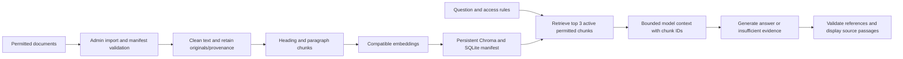

# IS373 Review 1 — evolving individual project record

Plan due **November 17, 2026, 1:00 PM Eastern**. Research/audit checked November 9, 2026.
Owner: Kushal Patel. This is the single individual record; extend its two sections through Build, Checked Release and Improve. Research is AI-assisted and recommendations remain provisional for student review. No portfolio or RAG implementation, hosted release, benchmark, or peer feedback is claimed here.

[Repository](https://github.com/kushalpatel71/my-app-studio) · [Plan branch](https://github.com/kushalpatel71/my-app-studio/tree/feature/review1-plan) · [Issue #7](https://github.com/kushalpatel71/my-app-studio/issues/7) · [PR #8](https://github.com/kushalpatel71/my-app-studio/pull/8) (open; not merged)

## Instructor requirements and repository audit

All five required pages were read on November 9 using direct HTTPS retrieval after browser-tool errors:
[milestones/rubric](https://kaw393939.github.io/is373-studio/course/milestones.html), [career handout](https://kaw393939.github.io/is373-studio/handouts/career-research.html), [database/RAG handout](https://kaw393939.github.io/is373-studio/handouts/database-rag-research.html), [record template](https://kaw393939.github.io/is373-studio/templates/project-record.html), [Plan example](https://kaw393939.github.io/is373-studio/examples/plan.html).
The Plan requires research, alternatives, a justified design and expected checks. A hosted link is optional at Plan. Canvas remains authoritative for the assignment box and deadline.

Audited latest remote `main`: [`15eaa35f87ed405d9dba3716a290f180d9fa4984`](https://github.com/kushalpatel71/my-app-studio/commit/15eaa35f87ed405d9dba3716a290f180d9fa4984). Fresh clone had a clean tree; `feature/review1-plan` was created from that revision. Read [README](../../README.md), [AGENTS](../../AGENTS.md), [SPEC](../../SPEC.md), [LEARNING](../../LEARNING.md), all three [lessons](../lessons/), source, security/database helpers, request/browser tests, contracts and CI. Origin is now `git@github.com:kushalpatel71/my-app-studio.git`; this is the student's public repository, not the instructor template.

| Stage | Real implementation and acceptance evidence | GitHub state verified through connector |
|---|---|---|
| APP-001 | [Showcase router](../../app/showcase.py), [brand/sample data](../../app/brand.json), templates/CSS, [route tests](../../tests/test_showcase.py), [homepage contracts](../../contracts/test_homepage.py), [browser journeys](../../tests/browser/test_browser.py). Home, build index, three detail pages, About; unknown slug 404; Next Step retained. | [Issue #1](https://github.com/kushalpatel71/my-app-studio/issues/1), [PR #2](https://github.com/kushalpatel71/my-app-studio/pull/2) merged at `fedd07c`. |
| APP-002 | [Accounts](../../app/features/accounts.py), [security](../../app/security.py), [SQLite database](../../app/database.py), [account contracts](../../contracts/test_accounts.py), [route tests](../../tests/test_account_routes.py). Signup member-only, hashing, HttpOnly JWT session, CSRF, private dashboard, server revocation at logout. | [Issue #3](https://github.com/kushalpatel71/my-app-studio/issues/3), [PR #4](https://github.com/kushalpatel71/my-app-studio/pull/4) merged at `e4f0753`. |
| APP-003 | [Roles](../../app/features/roles.py), [role contracts](../../contracts/test_roles.py), [admin tests](../../tests/test_admin_routes.py). Anonymous API 401, member 403, admin allowed; current database role overrides stale JWT role; trusted CLI changes affect existing sessions. | [Issue #5](https://github.com/kushalpatel71/my-app-studio/issues/5), [PR #6](https://github.com/kushalpatel71/my-app-studio/pull/6) merged at `15eaa35`. |

All three implementations are present on main; [studio.json](../../studio.json) declares `implemented_through: 3`. Historical SPEC/LEARNING contain stale pending/open language, including contradictory merge notes. Actual merged PR metadata and Git history establish integration; old prose is not treated as current status. Prior learner observations/AI help are attributed only to those existing records; this audit does not independently prove understanding or authorship. Current check receipt is recorded below. No existing application, test, contract, marker, workflow, SPEC or LEARNING content is changed by this Plan.

### 1. Individual portfolio + career research

**Status:** Research and Plan drafted; student reflection/selection review pending. Build (November 24), Checked Release (December 3) and Improve (December 10) are future work.

#### Research: three original employer records

These saved evidence notes summarize original employer-hosted postings checked **2026-11-09**. Direct HTTPS retrieval succeeded for all three. Palantir and GovWell include public JobPosting JSON-LD; Datadog includes readable posting/application text. The browser index also supplied matching descriptions, but direct original content was checked to avoid relying only on search snippets. No screenshots or applications were created. Public research summaries are suitable for this record; personal eligibility judgments and full career reflection stay private. These three examples do not establish market trends.

**J1 — Palantir Technologies, “Forward Deployed Software Engineer, New Grad - Commercial.”** Enterprise software; FDE family. [Original posting](https://jobs.lever.co/palantir/2e6b0ac8-83e9-4be5-a3aa-cf319f751728).

- Status: page/application available on check date; future vacancy unconfirmed. JSON-LD posted June 13, 2025; deadline not stated.
- New York, NY; full-time, hybrid; new graduate. Travel expectation 25–50% depending on team/location. Requires December 2026 or Spring 2027 graduation; student's graduation/work authorization and sponsorship eligibility unverified.
- Responsibilities: collaborate on architecture; build customer-specific applications/LLM workflows; manage stakeholder relationships through delivery.
- Required: engineering degree, programming proficiency, specified graduation window. Preferred degree fields include computing, engineering, mathematics and related sciences. “What We Value” emphasizes autonomy, ambiguity and customer outcomes; it is not a separate mandatory credential list.
- Supporting excerpt, “What We Require”: “Must be graduating in December 2026 or Spring 2027.”
- Existing evidence: Python/FastAPI application and server permission boundaries in APP-002/003 above; no enterprise customer delivery claimed.
- Gap: customer discovery/delivery experience. Proposed action by **November 12**: write three discovery questions for an actual portfolio reviewer and confirm graduation/travel eligibility privately.

**J2 — GovWell, “AI Product Engineer.”** Government software; AI product/application family. [Original posting](https://jobs.ashbyhq.com/GovWell/7c4cff34-bd8d-41d7-a54b-8f9ee0d96ac3/).

- Status: active posting metadata with direct application on check date; future vacancy unconfirmed. JSON-LD posted February 24, 2026; deadline not stated.
- New York, NY; full-time, hybrid, 3+ office days/week. Numeric seniority/years not stated; production experience makes this a longer-term reference, not verified entry-level eligibility. US location metadata; sponsorship/work authorization not established. Metadata says TELECOMMUTE but prose requires hybrid attendance; follow the more specific prose.
- Responsibilities: improve assistant retrieval/evaluation; prioritize fixes using production usage; ship and iterate AI features.
- Expected qualifications (“Who you are”): production LLM/RAG or evaluation experience, full-stack ability, product judgment and autonomy. No separately labeled preferred list; listed stack is context, not proof every technology is required.
- Supporting excerpt, “Who you are”: “Strong full-stack ability”.
- Existing evidence: FastAPI UI/API, automated account/role tests and iterative showcase delivery. This supports foundations, not existing AI expertise.
- Gap: evaluated retrieval/generation. Proposed action by **November 16**: finalize five expected-source questions and a citation-failure check for the RAG Build.

**J3 — Datadog, “Software Engineering Intern.”** Observability/security software; general software/platform family. [Original posting](https://careers.datadoghq.com/detail/8114186/?gh_jid=8114186&source=relomote.com), requisition 1065.

- Status: original description and application section available on check date; future availability unconfirmed. Posting date/deadline not visible.
- Paris, France; internship, hybrid. Pursuing CS/software engineering/related degree or equivalent practical experience; targeting 2027 full-time start; available six months starting February–June 2027. Student availability, relocation, French work authorization and sponsorship remain unverified; this is a verified internship posting, not a confirmed suitable application.
- Responsibilities: contribute to live observability data systems; improve distributed/cloud services; address performance/reliability/scaling problems.
- Qualifications under “Who You Are”: CS fundamentals, programming, AI-tool experience or interest, degree/equivalent and timing above. No separate preferred-qualification list. Kubernetes is a learning area, not an explicit prerequisite.
- Supporting excerpt, “Who You Are”: “Targeting a 2027 full-time start date”.
- Existing evidence: Python service, automated tests and GitHub PR delivery; no distributed-system scale claimed.
- Gap: distributed-systems observability. Proposed action by **November 13**: sketch request/error/latency measurements for the RAG service and privately verify internship timing/location eligibility.

#### Compare directions and choose the reader

| Direction | Regular work in this sample | Existing evidence | Missing evidence / course experiment |
|---|---|---|---|
| AI application/product engineering | GovWell: user-facing AI features, grounded answers, evaluation and iteration | FastAPI UI/API; security/access checks; documented showcase revision | RAG import/query trace and citations with expected-versus-observed evaluation; no production LLM work yet |
| Forward deployed engineering | Palantir: customer-specific integration, architecture and stakeholder delivery | Bounded application decisions and working account/role implementation | Real discovery, enterprise integration, stakeholder adoption and travel fit; course reviewer task can begin discovery but cannot establish professional FDE experience |

Platform engineering (Datadog) is a third family investigated: useful for reliability learning, with distributed-system depth still missing. **Recommendation:** provisionally target entry-level **AI Application / Product Engineering**, keeping FDE as a comparison. The current artifact evidence is closest to building and checking application behavior; a small RAG evaluation directly addresses the AI gap. This is an AI-assisted fit inference, not a claim that Kushal meets GovWell's experience bar or has confirmed personal travel preferences. The user supplied the provisional interest; personal reasons remain for the private reflection.

**Target reader:** a recruiter or internship reviewer hiring for entry-level AI application development. After viewing the portfolio, the reader should identify the intended direction, inspect one implemented capability, and distinguish completed work from planned AI work and the student's own contribution from AI/team help.

| Employer responsibility | Portfolio evidence today | Clearly labeled future evidence |
|---|---|---|
| GovWell: improve retrieval grounding/evaluation | Existing [test structure](../../tests/) demonstrates application checking only | RAG case study: versioned manifest, retrieved chunk IDs, five actual query results, claim/citation review and one improvement/retest |
| Palantir: build custom applications and make architecture decisions | [Showcase routes](../../app/showcase.py), [SPEC](../../SPEC.md), [PR #2](https://github.com/kushalpatel71/my-app-studio/pull/2) show a bounded enthusiast task and multi-page revision | Real reader discovery note; never label class/AI feedback as enterprise customer work |
| Datadog: own technical delivery with other engineers | [Check workflow](../../.github/workflows/check.yml), merged PRs above and actual checks below | Group case study with named issue/PR, personal diff, reviewer and integrated result; group repository and contribution not yet provided |

#### Plan: same content, two lightweight layouts

Shared content inventory for both options: introduction/direction, evidence-supported skills, individual RAG case study, group contribution case study, repositories/demos/checks, optional resume/LinkedIn, contact.

```text
Option A — Evidence-first (recommended)
Header: Kushal Patel | Projects | About | Contact
Short intro + provisional AI application direction
Featured work: Car Builders Place [implemented] | RAG [planned]
Case studies: task → my contribution/help → decision → evidence → limits
Skills with source links → Group work [pending evidence]
About → GitHub / demo links → optional resume/LinkedIn → contact

Option B — About-me-first
Header: Kushal Patel | About | Projects | Contact
Introduction + interests/direction
About and evidence-supported skills
Same project cards and case studies → same group-work placeholder
Same GitHub / demo links → optional resume/LinkedIn → contact
```

Choose **A** provisionally: it exposes inspectable work early for the target reader. The expected benefit is faster evidence discovery; this is a design hypothesis, not a peer-tested result. B may support a stronger personal narrative, but no employment history or credentials were supplied to populate that narrative. Use readable typography, restrained charcoal/lime accents related to the existing project, clear headings/focus, high contrast and responsive stacking. A practical “builder” voice is proposed; expertise should be demonstrated through links, never invented endorsements.

**Planned implementation/page outline:** reuse FastAPI/Jinja/shared styles on additive `/portfolio` and project-detail routes; leave existing Home/build/account/admin URLs and Next Step intact. Intro identifies the provisional direction without calling planned RAG work a mastered skill. Skills link Python/FastAPI, HTML/CSS, SQLite sessions, authorization and testing to the audited artifacts. Individual case study will show corpus permission, architecture, actual trace, setup and limits once built. Group case study requires a real group repository, task, personal contribution and review evidence; currently placeholder only. GitHub points to this repository. Demo URLs remain “not yet hosted”; no invented domain. Resume and LinkedIn are omitted until supplied. Professional contact is pending a student-approved email or contact URL; do not expose an inferred address.

**Planned observable portfolio checks (not executed):**

1. A reader can find the intended role and one linked implemented artifact from `/portfolio`; headings and links work by keyboard at desktop and 390px.
2. Each skill/case-study claim has a working evidence link and an accurate implemented/planned label; group contribution never implies sole authorship.
3. RAG project link opens a clearly labeled case study and, after Build, its actual chat; placeholder never resembles a working result.
4. Contact/resume/LinkedIn show only supplied, reviewed details; missing optional links are omitted and the chosen contact route is checked before publication.

**Changed:** added three sourced employer notes, comparison, target reader, mapping, two layouts and implementation outline. **Checked:** original postings and repository evidence read; no portfolio usability test or human review performed. **Next:** student confirms direction/layout and privately checks eligibility by November 12; confirm contact and group contribution links by November 16. **My contribution / AI assistance:** user supplied project/repository, constraints and provisional interest; AI researched, audited and drafted recommendations. Student's personal rationale, reflection and understanding have not been supplied and are not fabricated.

**Build / Checked Release / Improve:** pending. Future dates are November 24, December 3 and December 10 respectively; later add actual hosted revision, link/access checks and real peer observation → meaningful fix → retest here.

### 2. Individual RAG app + technical research

**Status:** proposed **Car Builds Knowledge Assistant**; research/design only. No import, vector, generated answer, benchmark or hosted RAG functionality exists or was tested in this task.

**Reader/task:** a Car Builders Place visitor asks how to navigate the sample builds and how to interpret illustrative modification information. Answer only from approximately five short owner-authored help documents. Exclude repair instructions, safety advice, measured performance, fitment claims and personal/account data. A small informational assistant provides a bounded portfolio case study.

#### Technical research and primary sources

Access date for the sources below: **2026-11-09**. These are research references, not permission to import their text into the corpus.

| Concept / source and relevant section | Explanation and design implication |
|---|---|
| [Lewis et al., RAG paper](https://arxiv.org/abs/2005.11401), abstract | RAG combines retrieval from external indexed evidence with generation. Our planned inference workflow retrieves passages before asking a model to answer; this is not a claim to reproduce the paper's training or results. |
| [Chroma adding data](https://docs.trychroma.com/docs/collections/add-data), Adding Data; [Chroma repository](https://github.com/chroma-core/chroma), Python client examples | A vector database stores embeddings and metadata with identifiable records for similarity retrieval. Chroma's unique IDs/document metadata support provenance. Local persistence/version compatibility must be verified in Build. |
| [MiniLM model card](https://huggingface.co/sentence-transformers/all-MiniLM-L6-v2), Intended uses / Usage | Embeddings map text into numeric representations for semantic comparison; they do not verify facts. This model outputs 384 dimensions and truncates beyond 256 word pieces by default. Record model revision/tokenizer and avoid silent truncation. |
| [Neo4j graph concepts](https://neo4j.com/docs/getting-started/appendix/graphdb-concepts/), nodes/relationships/properties | A graph represents entities (build, modification category, document) and typed relationships. Provenance must support every edge; extracted or inferred links can be wrong. |
| [SQLite FTS5](https://www.sqlite.org/fts5.html), Overview / query syntax / BM25 | Keyword search matches indexed terms and can rank passages; SQL filters explicit fields. This is a small reproducible baseline for source IDs and exact terms. |
| [Sentence Transformers models](https://www.sbert.net/docs/sentence_transformer/pretrained_models.html), Loading Models | Query and document encodings must use compatible configuration. Pin the actual model revision and package versions during implementation. |
| [Gemini 3.5 Flash-Lite](https://ai.google.dev/gemini-api/docs/models/gemini-3.5-flash-lite), model code/capabilities; [pricing](https://ai.google.dev/gemini-api/docs/pricing) | Proposed hosted generation model `gemini-3.5-flash-lite`; text output and structured output are documented. Availability to this account, actual cost and SDK compatibility remain untested. Vendor pricing is variable: check the current tier before enabling calls. |

Source provenance records who authored a document, its version/origin, permission and exact passage location. Import converts approved input into retained originals and cleaned text. Chunking splits that text into evidence units while keeping source mappings. Retrieval chooses relevant permitted units, model context packages those units with IDs, generation drafts an answer, and citations let readers inspect support. Citation validity requires both a real source location and support for the associated claim; a valid-looking ID alone is insufficient.

#### Compare bounded approaches and decide

| Approach | Representation / useful task | Cost and limit for this corpus |
|---|---|---|
| Keyword/SQL baseline | FTS5 passages plus structured source/version fields; exact “View Details” or source IDs | Few dependencies, deterministic inspection; paraphrases can miss wording |
| Vector | Chunk embeddings and cosine similarity; “where can I see the upgrades?” | May help paraphrases, requires model/index storage; nearest neighbor can still be irrelevant |
| Graph | Builds, categories, pages and typed edges; “which page describes this build?” | Explicit relationship traversal is inspectable; manual edge authoring/validation and another database are excessive for five short prose guides |
| Hybrid | Keyword + vector rank fusion with identical source filters, optionally graph traversal | Could retain exact terms and paraphrases; extra tuning and debugging need a measured benefit |

**Decision (proposed ADR R1): vector-first, retrieval-only baseline retained.** FastAPI/Jinja interface, Chroma local persistent store, `sentence-transformers/all-MiniLM-L6-v2` local embeddings, server-side Gemini `gemini-3.5-flash-lite` generation. Separate SQLite manifest/FTS5 database from the existing account database. Use one process/writer initially; no graph database or agent/tool execution. Passage-oriented questions fit vector retrieval; five documents do not justify graph operations. The choice tests a hypothesis about paraphrase retrieval, not a demonstrated improvement. Compare the same five queries using keyword and vector retrieval; add hybrid only if a specific observed miss warrants it.

**Simpler fallback:** SQLite FTS5 + the same generation API and source UI. If no API budget/access is available, provide an explicitly labeled search-only interface with quoted excerpts; it is not a completed RAG chat and does not satisfy the later real-generation Build requirement. Local embedding resource failure can trigger the FTS5 fallback without changing account/security behavior.

#### Proposed corpus and source manifest

All five entries below are **proposed, not authored/imported/permission-verified documents**. The intended author is Kushal Patel, with AI assistance disclosed if used. Their future owner approval must authorize storage, public demo excerpts and sending selected passages to the generation provider. Public repository availability does not alone authorize third-party reuse. No photos, employer text, copyrighted manuals, private reflections, student data, credentials or live account records enter the corpus.

| Stable ID | Proposed version/title and origin | Planned content and permission gate |
|---|---|---|
| CBP-S01 | v1 / Site navigation; planned `docs/rag/corpus/navigation.md` | Owner-authored description of Home, Builds, View Details and About, checked against [router](../../app/showcase.py). Pending author/license approval. |
| CBP-S02 | v1 / Understanding sample builds; planned `docs/rag/corpus/sample-builds.md` | Owner-authored explanation that samples are illustrative and not measured specifications, checked against [brand data](../../app/brand.json). Pending approval; no photo reproduction. |
| CBP-S03 | v1 / Modification categories; planned `docs/rag/corpus/categories.md` | New synthetic glossary of wheels, suspension, engine and performance labels; no vehicle fitment/repair advice. Pending author review/approval. |
| CBP-S04 | v1 / Accounts and access; planned `docs/rag/corpus/access.md` | Owner-authored public signup/login/dashboard/logout/member/admin explanation, checked against [accounts](../../app/features/accounts.py) and [roles](../../app/features/roles.py). Pending approval; exclude account details and promotion procedures. |
| CBP-S05 | v1 / Assistant scope and provenance; planned `docs/rag/corpus/assistant-scope.md` | New owner-approved assistant policy: interpret supplied sample content, expose sources, acknowledge absent measurements. Pending approval. |

Manifest fields to persist: `source_id`, title, author, version, original URI/path, origin type, license/permission evidence and approver/date, access scope, accessed/created date, raw SHA-256, cleaned SHA-256, active status, import outcome, chunking configuration, embedding ID/revision/dimensions and import time. Proposed paths become source URLs only after real files are created. Immutable source versions remain addressable for old citations; current retrieval excludes retired versions. Do not assign fabricated hashes or permission dates now.

#### Import and source-to-answer workflow



Graph alternative for comparison replaces chunks/embeddings with validated entities/relationships and bounded traversal returning supporting passages. It is not a second implemented pipeline.

1. Import allowlisted UTF-8 Markdown only, initially five files ≤20 KB each. Reject missing permission, invalid encoding, duplicate source IDs and out-of-root paths. No arbitrary URL fetching, uploads, PDFs or HTML in the initial scope.
2. Normalize line endings/whitespace; preserve headings, paragraph boundaries and original offsets. Do not remove qualifiers such as “illustrative.” Retain original and cleaned text with hashes.
3. Create deterministic versioned chunk IDs from source/version/section/ordinal and record exact text/span. Build a staging collection and activate a complete index version only after validation, avoiding partially updated results.
4. Repeat identical source/hash/config: report `unchanged` and keep counts/IDs. Changed source: create new version/chunks, retire old current entries atomically. Removed source: deactivate from retrieval, retain versioned source evidence under the retention rule. Re-embedding after model/chunker changes creates a new index version; never mix dimensions/models silently.
5. Question length ≤1,000 characters; retrieve top 3 chunks with active-version/public-scope filters. Apply the same filters before keyword and vector retrieval. Tune relevance/abstention on the small evaluation set, without claiming a universal similarity threshold.
6. Send only selected passages and their IDs, question and a fixed answer policy to the model. Source instructions are untrusted quoted data. Do not enable tools or let the model alter permissions. Require structured answer/claim-to-chunk references; no context means an insufficient-evidence response without an API call.
7. Reject nonexistent or unretrieved citation IDs; source links resolve through a server-controlled ID lookup to immutable passages. Review whether each factual claim is actually supported. Unknown/mismatched citations cause a safe error/abstention, not a fabricated source. Render escaped text and allowlisted links.

#### Representation sketches and chunking comparison

This is a **proposed synthetic sentence**, not imported repository content: “View Details opens an individual sample build page.”

```json
{
  "source_id": "CBP-S01",
  "version": "v1",
  "chunk_id": "CBP-S01:v1:navigation:001",
  "title": "Site navigation",
  "section": "Build details",
  "text": "View Details opens an individual sample build page.",
  "origin": "proposed docs/rag/corpus/navigation.md",
  "permission_status": "pending-owner-approval",
  "access_scope": "public-after-approval",
  "original_span": null,
  "content_sha256": null,
  "embedding_model": "sentence-transformers/all-MiniLM-L6-v2",
  "embedding_revision": null,
  "embedding_dimensions": 384,
  "embedding": null
}
```

Null values mean not computed, not verified. Numeric vectors must come from a real embedding run. Imports must reject this pending example until provenance/permission fields are complete.

**Graph sketch (comparison only):** `(Document {id:CBP-S01, version:v1}) -[DESCRIBES {support_chunk:CBP-S01:v1:navigation:001}]-> (Page {kind:BuildDetail})`; `(Link {label:View Details}) -[OPENS {support_chunk:...}]-> (Page {kind:BuildDetail})`. Validate each edge against approved text. A build/category `HAS_CATEGORY` edge would need its own explicit evidence; do not infer performance or part compatibility from category labels. Entity identity includes stable IDs; relationship properties retain source/version/span.

| Chunking method | Proposed parameters / trade-off | Worked boundary on a proposed fixture |
|---|---|---|
| Heading + paragraph (selected) | Keep heading with paragraph; cap at 200 word pieces measured with the pinned MiniLM tokenizer; split long paragraphs at sentences; no routine overlap | Keeps “Build details” with the full sentence. Retains semantic context; tiny sections may need title context. |
| Fixed characters | 40-character windows, 8-character overlap for the teaching sketch; later compare 600/100 as an experiment | On `Build details\nView Details opens an individual sample build page.`, first window ends `an indi`; next starts ` an individual...`. Repeats text and can sever the useful phrase. |

The boundary sketch is illustrative; character-window offsets were checked with a small Python string slice, but neither corpus chunker nor a retrieval comparison was executed. Character counts are not tokens. Actual ingestion must measure word pieces and preserve source offsets; the selected 200-word-piece cap leaves room under the model's documented truncation boundary. Inspect real boundary examples during Build, log both methods and choose based on retrieval results.

#### Evaluation questions and observable checks

All expectations depend on authoring the corpus as described; **no queries have run**. Before execution freeze corpus/index/model revisions. Record actual retrieved IDs/ranks, selected context, answer, claim support, opened citation location, latency and token/cost usage where measured. Compare keyword/vector retrieval separately from generation quality.

| Query | Type | Expected source/behavior |
|---|---|---|
| Where does “View Details” take me? | Exact term | CBP-S01 navigation; individual sample detail page |
| Where can I look at the upgrades on one example car? | Paraphrase | CBP-S01 + CBP-S02; explain navigation and illustrative nature |
| Which role may access the administration page? | Relationship/access | CBP-S04; admin role, members denied; no role-change instructions |
| What does the suspension category describe in this assistant? | Ordinary useful question | CBP-S03 glossary only; no real fitment/repair guarantee |
| What measured horsepower gain will this build give my car? | Missing evidence | Explicit insufficient evidence; CBP-S02/CBP-S05 may explain scope but cannot supply a number |

Planned retrieval check: expected relevant source appears in top 3 for each of the four supported questions; record exact source-level hit count out of four and ranks. Planned answer check: every factual claim supported, every citation resolves to the right version/passage, and missing-evidence question has no invented gain. Five questions are a tiny diagnostic set, not proof of general accuracy. Failure leads to inspecting source coverage/chunk boundary/retrieval before changing prompts; rerun the identical query and preserve before/after evidence. CBP-S05's scope rule should also be visible in the UI independently of retrieval.

| Observable user story | Intended check (all unexecuted) |
|---|---|
| Visitor asks a supported question and opens its sources | Answer references only retrieved active permitted chunks; clicking opens exact version/passage; manually verify each claim, plus inject an unknown/wrong citation and require rejection. |
| Visitor asks for absent evidence | Missing horsepower question returns insufficient evidence; unrelated nearest-neighbor chunks cannot justify a number; zero-hit query does not call the model. |
| Admin imports/updates permitted content | Import twice: same IDs/counts and `unchanged`; edit one source: new version without stale current hits; delete: no current retrieval; malformed/missing-permission input rejected without partial activation. Restart retains approved active index and source mappings. |
| Anonymous visitor or member tries administration directly | Anonymous import API 401, member 403, admin permitted with CSRF; direct requests tested independently of hidden buttons; demotion applies to current session; existing APP-001/002/003 checks still pass. |
| Visitor encounters limits or provider failure | Length/rate limits return clear errors; timeout/budget exhaustion shows search/source fallback with generation unavailable label; no key/token/private data in responses/logs and no fabricated answer. |

#### Hosting, resource, cost and security constraints

**No deployment recommended yet.** This repository proves FastAPI/SQLite and GitHub Actions checks. README references a separate Server Studio; it contains no verified Docker/Traefik deployment pipeline, server sizing or live hosting evidence. DigitalOcean/Docker/Traefik experience is user-reported context, not independently audited here. No server target or SSH host was supplied, and no remote resource observation occurred. Local laptop resources do not establish droplet capacity.

Before choosing a deployment target, record the authorized server's vCPU, RAM/free memory, disk/free space, architecture/OS, container limits, existing workload and ports, Docker/Traefik versions, volume/backups and domain/TLS ownership. Suggested read-only measurements after identifying the correct host: `nproc`, `free -h`, `df -h`, `docker stats --no-stream` and container resource configuration. Keep raw infrastructure details/private configuration out of public evidence. Do not change the shared server/proxy during this Plan.

Proposed deployment gate: one CPU worker, persistent private Chroma/manifest volumes and separate existing auth volume; measure peak import/query RSS, disk and idle/load behavior on the actual target and retain at least 30% memory headroom under the agreed workload before approving capacity. Indexing/model dependencies may outweigh the tiny corpus. If insufficient, keep ingestion local or use the simpler retrieval design and remeasure; no GPU or local generation model is assumed. Verify backup/restore and restart persistence before release. Docker/Traefik can be reused only after this audit; do not expose the database port or Docker socket. GitHub Actions currently checks code; deployment would need a separately reviewed workflow.

Proposed bounds: five ≤20 KB documents, one import at a time, top 3 passages, ≤2,000 context tokens and ≤400 output tokens, one generation request at a time, 20-second provider timeout, 5 requests/minute/session plus an app-wide daily cap. Select an application-enforced **$5/month maximum** only after student approval; this is a proposed ceiling, not a price quote or current spend. Estimate `(input tokens × current input rate + output tokens × current output rate)` with the vendor's unit scaling, then log actual usage and stop before the approved cap. Free tier/quota, billing access and generation credentials are not confirmed. Never assume provider budget alerts enforce a hard cap.

Keep API credentials server-side in ignored environment/secret storage; no browser key, Git history or CI log exposure. Existing auth signing keys/account database are not retrieval inputs. Import requires current server admin checks and CSRF. Use permitted public sample text only; review provider data-handling terms before sending passages. Redact request logs, avoid retaining user questions by default, use no external tool execution, prevent arbitrary file/URL access, and treat source prompt injection as data. Rate limits are application controls, not proof of complete security.

**Changed:** added technical research, comparisons, ADR, five proposed sources/manifest, representations, workflow, chunking alternatives, expected queries, stories and conditional hosting plan. **Checked:** original technical sources read and app boundaries inspected; no RAG code/model/API/query or resource benchmark executed. **Next:** student approves/authors corpus and confirms permissions by November 13; review architecture/budget/credentials and identify server for resource audit by November 16; implement only after this Plan review. **My contribution / AI assistance:** user proposed the Car Builds topic and reuse constraints; AI researched and drafted architecture/checks. No student technical explanation or implementation result is inferred from acceptance of a proposal.

**Build / Checked Release / Improve:** pending. November 24 requires a real small hosted import → retrieval → chat journey and hosted portfolio foundation. December 3 adds persistent hosted service, actual query evaluation and repeatable setup. December 10 requires a real peer task/observation, meaningful change and retest. Neither planned checks nor AI critique count as executed evaluation or human peer feedback.

## Verification and Plan rubric crosswalk

| Criterion (25 points each; no self-assigned grade) | Current evidence / remaining limit |
|---|---|
| Complete | Both exact individual headings; three postings, comparison/map/two layouts; RAG manifest/architecture/import/evaluation/hosting plan. Planned source permissions and student review are explicit. |
| Thoughtful | Employer responsibilities motivate evidence-first layout; vector/graph/baseline/hybrid compared; bounded decision and simpler fallback. Fit/performance are hypotheses. |
| Checked | Original pages/direct posting evidence, actual merged PR metadata and latest-main source audit; actual check receipt below. Planned portfolio/RAG checks distinguished from execution. |
| Understood | Decisions/limits/help disclosed; user-supplied direction separated from AI recommendations; student reflection/explanation still needs personal completion. Existing LEARNING is linked, not rewritten or fabricated. |

**Actual project checks (November 9, 2026):** `python3 studio.py setup` completed with the repository-pinned environment and Chromium. `python3 studio.py check` exited **0** on macOS / Python **3.14.3**: Black left 27 files unchanged; Pylint passed; **110 foundation/request tests passed**, **18 contracts through APP-003 passed**, and **11 real Chromium cases passed**. The first pytest selection deselected 11 browser cases; the browser selection later ran those 11 and deselected the 110 other cases. Those deselections are not skipped failures. A Starlette/httpx deprecation warning occurred and did not fail the run. Existing tests, instructor contracts and acceptance requirements were unchanged. This verifies the tested local APP-001/002/003 behavior, not RAG, hosting, complete security or student understanding. Raw local log: `/tmp/review1-check.log`; ignored receipt: `runtime/check-APP-003.json`. PR CI results are separate and must be checked on the actual published revision.

**Diff/privacy review:** documentation only; no secret values, credentials, private career reflection, invented biography, source permission, screenshots, peers, test passes or deployed URLs. Existing code/tests/contracts/workflows are outside the diff. Empty reflection prompts are kept outside the repository; no full personal reflection belongs here.

**Student review before submission:** confirm original job pages and eligibility privately; complete the private reflection in own words; review provisional direction/layout and explain why; author/approve five sources; choose professional contact and optionally supply resume/LinkedIn; supply real group project/contribution evidence; confirm budget/provider data terms and actual server constraints. These are open items, not actions completed by AI.

## Canvas-ready individual Plan submission

Copy this section after reviewing the pending decisions. No hosted URL is required at Plan.

### 1. Individual portfolio + career research

Repository: https://github.com/kushalpatel71/my-app-studio

Portfolio/career Plan: https://github.com/kushalpatel71/my-app-studio/blob/feature/review1-plan/docs/review1/README.md#1-individual-portfolio--career-research

Changed: added three original employer records (Palantir FDE new graduate, GovWell AI Product Engineer, Datadog Software Engineering Intern), two-direction comparison, target reader, responsibility/evidence map and two layouts. AI application/product engineering and an evidence-first layout are provisional recommendations. Checked: original posting content and existing repository evidence; personal eligibility remains unconfirmed. Next: complete my private reflection, review direction/layout, and confirm contact/group-contribution links. The professional portfolio is planned, not built or hosted. Research and drafting were AI-assisted; no personal reflection or professional credentials were invented.

### 2. Individual RAG app + technical research

RAG technical Plan, source manifest and expected query/checks: https://github.com/kushalpatel71/my-app-studio/blob/feature/review1-plan/docs/review1/README.md#2-individual-rag-app--technical-research

Changed: planned the Car Builds Knowledge Assistant with five proposed owner-authored sources, retrieval comparison, vector-first architecture, import/chunk/graph sketches, source-reference workflow, five evaluation questions and hosting constraints. Checked: primary technical documentation and existing app/security boundaries; no RAG import, retrieval, embedding, generation or evaluation has run. Next: author/approve source permissions, review models/budget and audit actual server capacity before Build. Proposed stack: FastAPI, persistent Chroma, MiniLM embeddings and server-side Gemini generation, with SQLite keyword retrieval as a simpler fallback. No deployment or merge was performed; November 24 Build, December 3 release and December 10 peer review remain future work.

Actual local regression check: `python3 studio.py check` passed Black, Pylint, 110 foundation/request tests, 18 APP-003 cumulative contracts and 11 Chromium cases on November 9, 2026. Existing application behavior and instructor tests are preserved. This result does not establish RAG functionality.

Plan workflow: https://github.com/kushalpatel71/my-app-studio/issues/7

Pull request: https://github.com/kushalpatel71/my-app-studio/pull/8
